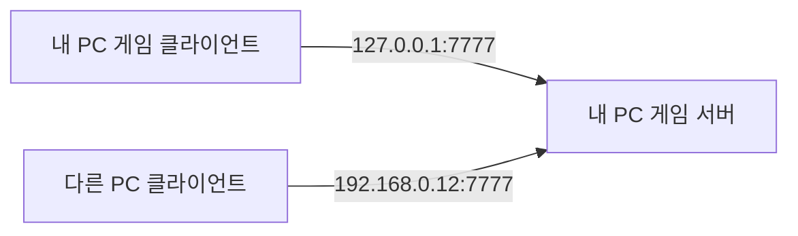
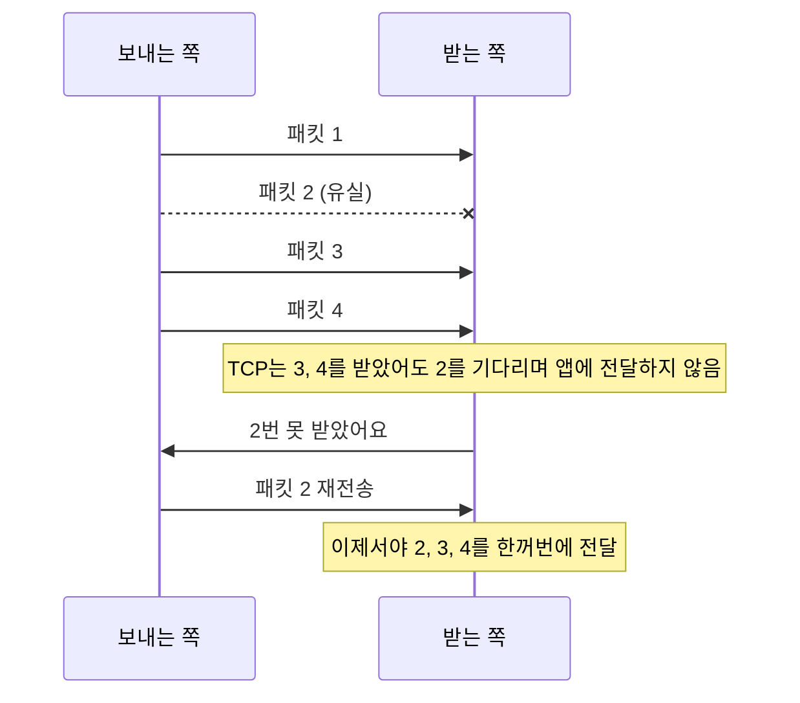
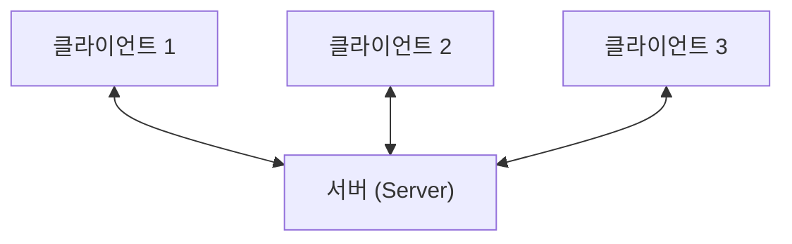
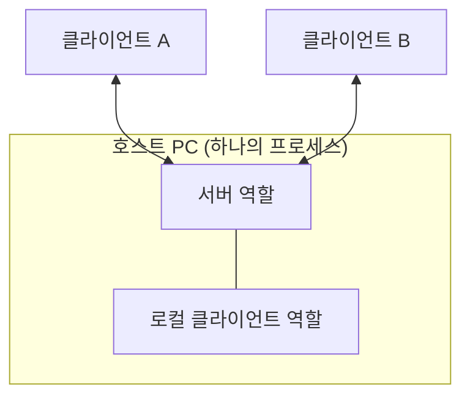
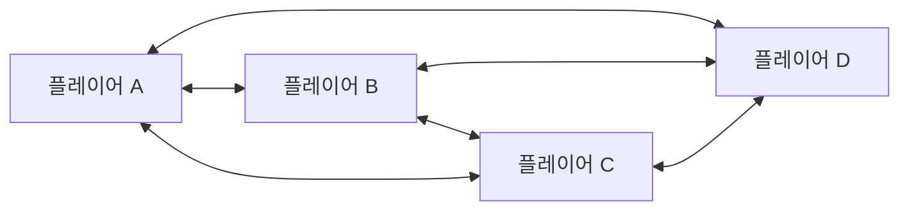
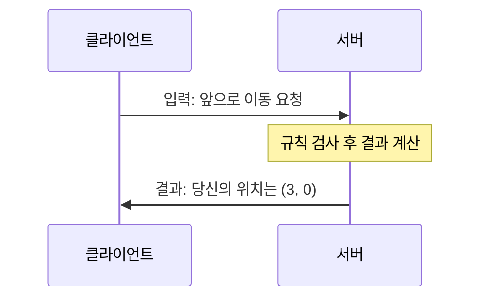
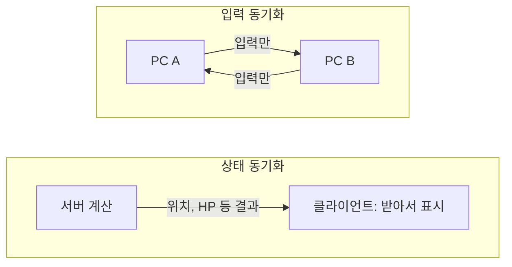
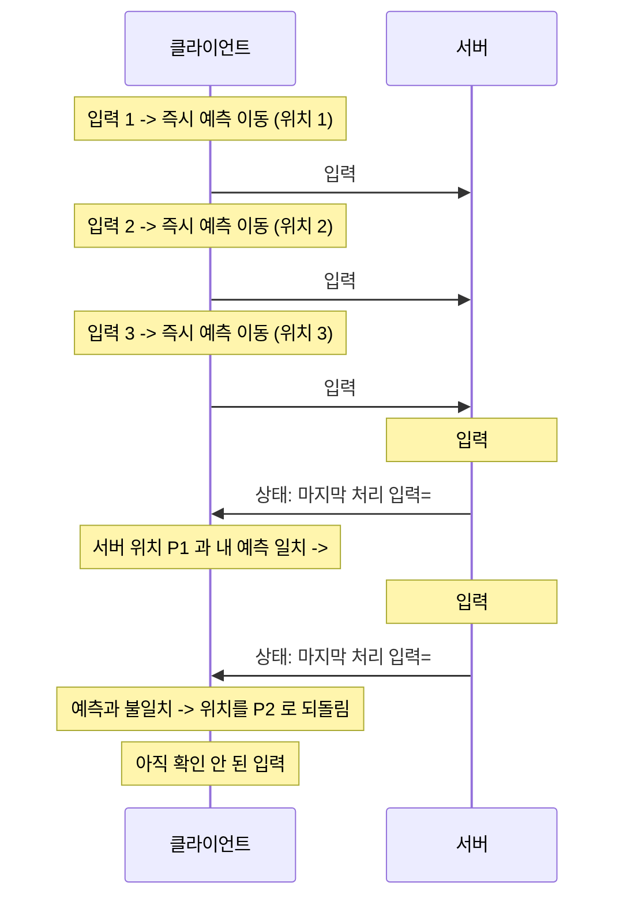
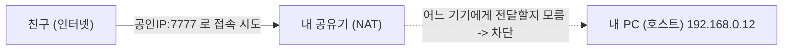
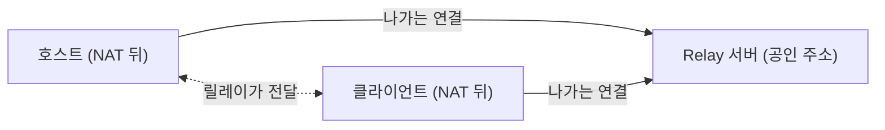

# 00. 네트워크 기초 — NGO 들어가기 전에 꼭 알아야 할 것들

> Unity Netcode for GameObjects(NGO 2.x)를 배우기 전, 코드 없이 **개념**만 잡는 장입니다.
> 비유로 먼저 감을 잡고, 그다음 정확한 용어를 붙입니다. 용어는 영어를 괄호로 함께 적습니다.

## 목차

1. [이 교안의 사용법](#1-이-교안의-사용법)
2. [패킷과 주소](#2-패킷과-주소)
3. [TCP vs UDP](#3-tcp-vs-udp)
4. [지연, 지터, 패킷 손실](#4-지연-지터-패킷-손실)
5. [네트워크 구조](#5-네트워크-구조)
6. [권한(Authority)](#6-권한authority)
7. [틱(Tick)과 동기화](#7-틱tick과-동기화)
8. [동기화 도구 3종 미리보기](#8-동기화-도구-3종-미리보기)
9. [지연 숨기기 미리보기](#9-지연-숨기기-미리보기)
10. [인터넷 너머 접속](#10-인터넷-너머-접속)
11. [용어 사전](#11-용어-사전)
12. [확인 퀴즈](#12-확인-퀴즈)

---

## 1. 이 교안의 사용법

이 저장소는 **00장부터 06장**까지 구성되어 있습니다.

| 장 | 내용 | Git 태그 |
|----|------|----------|
| 00 | 네트워크 기초 (이 문서, 코드 없음) | 없음 |
| 01 ~ 06 | 단계별 실습 | `ch01` ~ `ch06` |

- 각 장에는 Git 태그 `ch01` ~ `ch06` 이 붙어 있고, 태그 시점에는 **그 단계까지의 코드만** 들어 있습니다.
- 진행 순서는 항상 같습니다.
  1. 해당 장의 문서를 읽는다.
  2. 아래처럼 태그를 체크아웃한다.
  3. Unity에서 열고 실행해 본다.

```bash
git checkout ch01
```

- 다른 장으로 가고 싶으면 `git checkout ch02` 처럼 태그만 바꾸면 됩니다.
- 작업 중이던 변경이 있으면 먼저 커밋하거나 `git stash` 로 치워 두세요.
- 처음으로 돌아오려면 `git checkout -` 또는 원래 브랜치 이름(예: `main`)으로 체크아웃합니다.

> 💡 **바이브 코딩 팁**: AI에게 코드를 시킬 때도 이 문서의 용어(서버 권한, RPC, NetworkVariable 등)를
> 정확히 쓰면 훨씬 정확한 결과가 나옵니다. "동기화해줘" 보다 "서버 권한으로 NetworkVariable에 저장해줘"가 낫습니다.

---

## 2. 패킷과 주소

### 2.1 비유: 택배

네트워크로 데이터를 보내는 건 **택배**와 같습니다.

- 큰 이사짐은 한 번에 못 보냅니다. 작은 **상자**로 나눠 보냅니다. → 이 상자가 **패킷(packet)**
- 상자에는 **받는 집 주소**가 적혀 있습니다. → **IP 주소(IP address)**
- 그 집(건물) 안의 **몇 호**인지도 적혀 있습니다. → **포트(port)**

### 2.2 패킷(packet)

데이터를 잘게 나눈 한 덩어리입니다. 대략 이런 구조입니다.

```text
+-------------------+-----------------------+
| 헤더(header)      | 내용(payload)         |
| 보낸 곳/받는 곳   | 실제 게임 데이터      |
| 주소, 포트 등     | 예: "내 위치는 (3, 0)"|
+-------------------+-----------------------+
```

- 한 패킷의 크기에는 한계가 있습니다. 보통 인터넷에서는 약 1,500바이트(MTU) 안쪽으로 맞추고,
  게임은 여기서 헤더를 뺀 **1,000바이트대 이하**로 작게 보내려 합니다.
- 큰 데이터는 여러 패킷으로 쪼개져 가고, 받는 쪽에서 다시 합칩니다(조각화, fragmentation).
- 패킷은 **도중에 사라지거나, 순서가 바뀌거나, 늦게 도착**할 수 있습니다. 이것이 이 문서 전체의 출발점입니다.

### 2.3 IP 주소(IP address)

- 네트워크에서 **기기를 구분하는 번호**입니다. 예: `192.168.0.12` (IPv4 형식)
- 비유: 아파트 단지의 **동 주소**.

### 2.4 포트(port)

- 한 컴퓨터에는 프로그램이 여러 개 돌아갑니다(브라우저, 메신저, 게임…).
  도착한 패킷을 **어느 프로그램에게 줄지** 정하는 번호가 포트입니다.
- 범위는 0 ~ 65535. 비유: **호수**.
- `IP:포트` 로 적습니다. 예: `192.168.0.12:7777`

### 2.5 게임은 왜 포트를 정해 두나?

- 서버는 "손님이 올 문"을 **미리 정해 열어 두고 기다려야** 합니다. 그래야 클라이언트가 그 문을 두드릴 수 있습니다.
- 클라이언트는 아무 포트나 자동으로 써도 되지만, **서버는 약속된 포트**가 필요합니다.
- 이미 쓰이는 흔한 포트(80 웹, 443 HTTPS 등)를 피해 **충돌하지 않는 번호**를 고릅니다.
- **NGO의 Unity Transport(`UnityTransport`) 기본 포트는 `7777`** 입니다.
  (Inspector의 Connection Data 항목에서 Address / Port 를 볼 수 있습니다.)

### 2.6 localhost 와 127.0.0.1

- `127.0.0.1` 은 **"나 자신"** 을 가리키는 특별한 주소입니다. 이름은 `localhost`.
- 비유: 택배를 **내 집 현관**으로 보내는 것. 인터넷으로 나가지 않고 내 컴퓨터 안에서만 돕니다.
- 같은 PC에서 Unity 에디터와 빌드된 게임을 동시에 띄워 테스트할 때 쓰는 주소입니다.
  기본 접속 주소도 `127.0.0.1` 이므로 처음엔 설정 없이 한 PC에서 서버/클라이언트 테스트가 됩니다.
- 다른 PC(같은 공유기 아래)에 접속하려면 그 PC의 **사설 IP**(예: `192.168.0.x`)를 입력합니다.
- 서버 쪽에는 "어떤 네트워크 카드에서 들어오는 연결을 받을까"를 정하는 **Listen 주소**도 있습니다.
  `127.0.0.1` 로만 열면 내 PC 안에서만 접속되고, `0.0.0.0` 은 "모든 인터페이스에서 받기"를 뜻합니다.



---

## 3. TCP vs UDP

패킷을 보내는 대표적인 두 가지 규칙(프로토콜, protocol)이 있습니다.

### 3.1 비유

- **TCP = 등기 우편 + 전화 통화**
  - 먼저 "여보세요?" 하고 연결을 맺는다(핸드셰이크).
  - 보낸 건 **받았는지 확인**하고, 못 받았으면 **다시 보낸다**.
  - 번호표 순서대로 **반드시 순서대로** 전달한다.
- **UDP = 엽서**
  - 연결 없이 그냥 던진다.
  - 도착했는지 안 알려준다. 잃어버릴 수도, 순서가 바뀔 수도 있다.
  - 대신 **빠르고 가볍다**.

### 3.2 비교표

| 항목 | TCP | UDP |
|------|-----|-----|
| 연결 | 먼저 연결을 맺음 | 연결 없음 |
| 신뢰성(reliability) | 보장 (유실 시 재전송) | 보장 안 함 |
| 순서(ordering) | 보장 | 보장 안 함 |
| 속도/오버헤드 | 상대적으로 느리고 무거움 | 빠르고 가벼움 |
| 흔한 용도 | 웹, 파일 전송, 이메일 | 실시간 게임, 음성/영상 통화 |

### 3.3 줄 서기 문제: Head-of-line blocking

TCP는 순서를 지키기 때문에, 중간에 패킷 하나가 사라지면 **뒤에 이미 도착한 패킷도 그 하나가 재전송돼 도착할 때까지 기다립니다.**

비유: 계산대 줄에서 앞사람이 결제 오류로 막히면 뒤 사람들이 모두 멈추는 상황.



게임에서 이게 왜 문제일까요?

- 0.1초 전의 "캐릭터 위치 (3, 0)" 패킷이 사라졌다고 합시다. 이미 **더 새로운 위치 (4, 0)** 가 도착했는데
  옛날 위치가 재전송될 때까지 새 위치를 못 쓰면 화면이 **멈칫**합니다.
- 위치 같은 정보는 **옛날 것을 다시 받을 필요가 없습니다.** 다음 패킷이 곧 덮어쓰니까요.

### 3.4 그래서 게임은 UDP 위에 직접 만든다

- 게임은 대부분 **UDP**를 쓰고, 꼭 필요한 부분에만 **신뢰성을 직접 얹습니다.**
- 즉 "모든 데이터를 TCP처럼"이 아니라 **데이터 종류별로 골라 쓰는** 방식입니다.
- NGO가 사용하는 **Unity Transport(UTP)** 는 UDP 기반이며, 신뢰성/순서를 **파이프라인(pipeline)** 으로 제공합니다.
  NGO에서는 이를 `NetworkDelivery` 로 고를 수 있습니다.

| 전송 방식 (`NetworkDelivery`) | 의미 | 어울리는 데이터 |
|------------------------------|------|----------------|
| `Unreliable` | 유실·순서 뒤바뀜 가능, 가장 가벼움 | 자주 갱신되는 값, 잠깐 쓰고 버릴 이펙트 |
| `UnreliableSequenced` | 유실은 가능하지만 **옛날 패킷은 버려 순서 역행을 막음** | 위치·회전처럼 최신값만 중요한 것 |
| `Reliable` | 반드시 도착(재전송). 순서는 보장 안 될 수 있음 | 순서 상관없는 중요 사건 |
| `ReliableSequenced` | 반드시 도착 + 순서 보장 | 아이템 획득, 점수, 채팅처럼 놓치면 안 되고 순서도 중요한 것 |
| `ReliableFragmentedSequenced` | 위와 같되 **큰 데이터를 쪼개서** 전송 | 한 패킷에 안 들어가는 큰 메시지 |

> ⚠️ 정확한 이름과 동작은 사용 중인 NGO / Unity Transport 버전의 문서에서 한 번 더 확인하세요.
> 핵심 아이디어는 "**신뢰성은 공짜가 아니다. 꼭 필요한 데이터에만 쓴다**"입니다.
> (NGO의 RPC는 기본적으로 신뢰성 있는 전송을 쓰고, 필요하면 Unreliable 옵션을 고를 수 있습니다.)

---

## 4. 지연, 지터, 패킷 손실

### 4.1 비유: 고속도로

- **지연(latency)**: 목적지까지 가는 데 걸리는 **시간**.
- **지터(jitter)**: 그 시간이 **들쭉날쭉**한 정도 (어제는 30분, 오늘은 50분, 내일은 35분).
- **패킷 손실(packet loss)**: 중간에 **짐이 사라지는** 일.
- **대역폭(bandwidth)**: 도로의 **차선 수**. 한 번에 보낼 수 있는 양.

> 헷갈리기 쉬운 점: 대역폭이 넓다고(차선이 많다고) 지연이 짧아지는 게 아닙니다.
> 차선이 100개여도 서울-부산 거리는 그대로입니다. 게임은 보통 **대역폭보다 지연이 문제**입니다.

### 4.2 지연(latency)과 RTT(ping)

- **편도 지연(one-way latency)**: 내가 보낸 패킷이 서버에 닿는 시간.
- **왕복 시간(RTT, Round-Trip Time)**: 보내고 응답이 돌아오는 데까지 총 시간. 흔히 말하는 **핑(ping)** 이 이것입니다.

```text
예시) 편도 50ms 라면
  클라이언트 ──50ms──▶ 서버
  클라이언트 ◀──50ms── 서버
  RTT = 50 + 50 = 100ms  (핑 100)
```

- 단, 실제로는 왕복이 대칭이 아닐 수 있고 서버 처리 시간도 더해집니다.
  입문 단계에서는 `RTT ≈ 편도 × 2` 로 생각하면 충분합니다.
- 1초 = 1000ms 입니다. 60fps 게임의 한 프레임은 약 16.7ms 이므로, 핑 100ms 는 **약 6프레임 늦다**는 뜻입니다.

#### 핑 체감 가이드 (대략적인 감)

| RTT | 체감 |
|-----|------|
| ~30ms 이하 | 거의 못 느낌 (같은 지역 유선) |
| 30~80ms | 쾌적함 |
| 80~150ms | 빠른 액션 게임에서 약간 둔함을 느낌 |
| 150~300ms | 조작이 늦고 맞췄는데 안 맞는 느낌 |
| 300ms 이상 | 플레이 힘듦 |

게임 장르마다 허용 범위는 다릅니다. 턴제 카드 게임은 300ms 도 괜찮고, 격투 게임은 100ms 도 치명적입니다.

### 4.3 지터(jitter)

지연이 일정하면 오히려 적응할 수 있습니다. 문제는 **들쭉날쭉**입니다.

```text
패킷이 20ms 간격으로 보내졌는데 도착 시각은...
  보냄:   0   20   40   60   80
  도착:  50   72   95   150  152   ← 간격이 제각각
  지연:  50   52   55   90   72   (ms)  → 지터 있음
```

- 도착 간격이 들쭉날쭉하면 상대 캐릭터가 **부드럽게 안 움직이고 툭툭 끊기며 순간이동**합니다.
- 해결의 큰 줄기: 받은 데이터를 **조금 늦게 재생하며 버퍼링**(보간, interpolation — 9장에서 설명).

### 4.4 패킷 손실(packet loss)

- 100개 보냈는데 2개가 도착하지 않으면 손실률 **2%**.
- 원인: 와이파이 간섭, 혼잡한 회선, 라우터 큐 넘침 등.
- 게임에서의 체감:
  - 위치 패킷 손실 → 캐릭터가 잠깐 멈췄다가 튐 (러버밴딩, rubber-banding: 고무줄에 당겨진 듯 되돌아가는 현상)
  - 중요한 사건(아이템 획득) 손실 → 재전송이 없다면 **영영 반영 안 됨**. 그래서 이런 건 Reliable 로 보냅니다.
- 3장의 TCP 였다면 손실 하나가 뒤 패킷 전체를 막으니 지연으로 변합니다. **손실은 결국 지연이나 끊김으로 느껴집니다.**

### 4.5 대역폭(bandwidth)

- 단위 시간에 보낼 수 있는 데이터 양 (예: 10 Mbps).
- 게임 한 명이 쓰는 양은 보통 작지만, **서버는 접속자 수만큼 곱해서** 보냅니다.

```text
계산 예시
  플레이어 1명의 상태 = 50바이트
  틱 30회/초
  플레이어 10명에게 전부 알림

  한 클라이언트가 받는 양 = 50B × 10명 × 30 = 15,000 B/s ≈ 15 KB/s
  서버가 보내는 총량     = 15 KB/s × 10명  = 150 KB/s
```

- 접속자가 늘면 **제곱(N×N)** 으로 커질 수 있습니다. 그래서 "필요한 것만, 필요한 때만" 보내는 게 중요합니다.

### 4.6 한눈에 보기

| 용어 | 비유 | 게임에서 느낌 |
|------|------|--------------|
| 지연(latency) | 도착까지 걸리는 시간 | 조작 후 반응이 늦음 |
| 지터(jitter) | 도착 시간의 들쭉날쭉함 | 상대가 툭툭 끊기며 움직임 |
| 패킷 손실(packet loss) | 짐 분실 | 멈칫, 순간이동, 되돌아가기 |
| 대역폭(bandwidth) | 차선 수 | 접속자·오브젝트가 많을 때 렉 |

---

## 5. 네트워크 구조

"누가 누구와 연결되는가?"의 설계입니다.

### 5.1 클라이언트-서버(client-server)

- 비유: **식당**. 손님(클라이언트)은 주방(서버)에만 주문하고, 손님끼리 직접 거래하지 않습니다.
- 모든 클라이언트는 **서버 하나**와만 연결됩니다. 서버가 중간에서 정리하고 나눠줍니다.



NGO는 이 구조를 기본으로 합니다. 서버를 어떻게 띄우느냐에 따라 두 가지가 있습니다.

### 5.2 전용 서버(dedicated server)

- 화면 없이 **서버 역할만** 하는 별도 프로세스(보통 별도 컴퓨터/클라우드).
- 비유: 손님은 없고 **주방만 있는 배달 전문 주방**.

| 장점 | 단점 |
|------|------|
| 공정하고 안정적 (서버가 플레이어와 분리) | 서버 운영 비용·관리 필요 |
| 서버 사양을 확보하기 쉬움 | 개발·배포 과정이 더 복잡 |
| 치팅 방어에 유리 | 소규모 프로젝트엔 과함 |

### 5.3 리슨 서버(listen server)와 호스트(Host)

- 플레이어 중 한 명이 **서버 + 클라이언트를 한 프로세스에서 동시에** 맡습니다.
- NGO에서는 이를 **호스트(Host)** 라고 하며 `NetworkManager.Singleton.StartHost()` 로 시작합니다.
- 비유: **사장님이 주방도 보고 홀에서 같이 식사도 하는 작은 가게.**



| 장점 | 단점 |
|------|------|
| 별도 서버 불필요, 시작이 쉬움 | 호스트 플레이어는 **지연 0** 으로 유리함 |
| 비용 없음 | 호스트의 회선·PC 성능이 곧 서버 품질 |
| 친구끼리 놀기에 최적 | 호스트가 나가면 **게임 종료** (호스트 마이그레이션은 기본 제공 아님) |
| 입문 학습에 적합 | 호스트가 치터면 방어 불가 |

NGO에서 실행 모드는 보통 이 세 가지로 시작합니다.

| 시작 함수 | 의미 |
|-----------|------|
| `StartHost()` | 서버 + 클라이언트 (호스트) |
| `StartServer()` | 서버만 (전용 서버) |
| `StartClient()` | 클라이언트만 |

### 5.4 P2P (peer-to-peer)

- 모두가 **서로서로 직접** 연결됩니다. 비유: **친구들끼리 서로 전화번호를 다 아는 단톡 통화 연결.**



| 장점 | 단점 |
|------|------|
| 서버 비용 없음 | 연결 수가 N×(N-1)/2 로 늘어남 |
| 중간 거치지 않아 지연이 짧을 수 있음 | 누가 진실인지 정하기 어려움, 치팅에 취약 |
| 격투 게임 등 소규모 대전에 사용 | NAT 통과가 복잡 (10장) |

> NGO는 **클라이언트-서버 모델**입니다. P2P 구조 자체는 NGO의 기본 모델이 아니므로 이 교안에서는 개념 비교용으로만 다룹니다.

### 5.5 구조 비교

| 구조 | 비용 | 치팅 방어 | 구현 난이도 | 대표 사용처 |
|------|------|-----------|-------------|-------------|
| 전용 서버 | 높음 | 강함 | 중~높음 | 대규모/경쟁 게임 |
| 리슨 서버(Host) | 낮음 | 약함 | 낮음 | 협동, 친구끼리 게임 |
| P2P | 낮음 | 약함 | 높음 | 소규모 대전, 락스텝 게임 |

---

## 6. 권한(Authority)

### 6.1 "누가 진실을 쥐고 있나?"

네트워크 게임의 핵심 질문입니다. 같은 장면을 여러 컴퓨터가 각자 보고 있는데,
**서로 다른 말을 하면 누구 말이 맞는가?** 그 결정권이 **권한(authority)** 입니다.

비유: 축구 경기의 **주심**. 선수들이 "내가 먼저 터치했어요" 하고 우겨도, 주심 판정이 곧 사실입니다.

### 6.2 서버 권한(server-authoritative)

- **서버가 진실.** 클라이언트는 "나 이렇게 하고 싶어요(입력)"만 보내고, 결과는 서버가 계산해 알려 줍니다.
- 비유: 손님은 주문서만 내고, 요리는 주방이 결정.



### 6.3 클라이언트(오너) 권한(client/owner-authoritative)

- **클라이언트가 자기 캐릭터의 결과를 직접 정해서 서버에 통보**합니다.
- 비유: 손님이 "나 계산했어요, 5천 원 냈어요"라고 **자기 입으로 말하고 끝**.
- 장점: 조작이 즉각적이고 구현이 쉽다. 지연을 거의 못 느낀다.
- 단점: **조작된 값을 그대로 믿게 된다.**

### 6.4 치팅 예시

```text
[클라이언트 권한일 때]
  치터의 클라이언트: "내 위치는 (9999, 0) 야!" → 서버: "그래, 알겠어" → 벽 통과, 순간이동 성공

  치터의 클라이언트: "내 HP 는 항상 100 이야" → 서버: "OK"

[서버 권한일 때]
  치터의 클라이언트: "(9999, 0) 으로 갈래" → 서버: "속도 제한 초과. 거부. 현재 위치 (3, 0) 유지"
```

원칙: **클라이언트는 믿지 않는다(Never trust the client).**
그렇다고 항상 서버 권한이 정답은 아닙니다. 협동 게임이나 지연이 중요한 단순 게임에서는 오너 권한도 흔히 씁니다.
속도(반응성)와 안전(치팅 방어)의 **트레이드오프**입니다.

| 항목 | 서버 권한 | 오너(클라이언트) 권한 |
|------|-----------|----------------------|
| 치팅 방어 | 강함 | 약함 |
| 조작 반응 | 지연이 느껴짐 (예측 필요, 9장) | 즉각적 |
| 구현 | 더 복잡 | 단순 |
| 추천 | 경쟁 게임, 중요한 규칙 | 협동 게임, 프로토타입 |

### 6.5 NGO의 소유권(Ownership)

NGO에서 네트워크 오브젝트(`NetworkObject`)는 **주인(owner)** 이 있습니다.
기본적으로 서버가 모든 오브젝트의 권한을 갖고, 플레이어 캐릭터는 그 플레이어(클라이언트)가 owner 가 됩니다.

| 속성 | 뜻 | 비유 |
|------|----|------|
| `OwnerClientId` | 이 오브젝트 주인의 클라이언트 ID (`ulong`) | 명찰에 적힌 주인 번호 |
| `IsOwner` | **내가** 이 오브젝트의 주인인가? | "이거 내 거야?" |
| `IsServer` | 지금 코드가 **서버** 역할로 실행 중인가? (호스트도 true) | "나는 주방 사람?" |
| `IsClient` | 지금 코드가 **클라이언트** 역할로 실행 중인가? (호스트도 true) | "나는 손님?" |
| `IsHost` | 서버이면서 클라이언트인가? | "사장님 겸 손님?" |

(이들은 `NetworkBehaviour` 에서 접근하는 속성입니다.)

**실행 형태별 값 정리**

| 실행 형태 | IsServer | IsClient | IsHost |
|-----------|----------|----------|--------|
| 호스트 (`StartHost`) | true | true | true |
| 전용 서버 (`StartServer`) | true | false | false |
| 순수 클라이언트 (`StartClient`) | false | true | false |

`IsOwner` 는 위 값과 별개로 **오브젝트마다** 다릅니다. 예를 들어 클라이언트 B 가 접속한 상태에서:

```text
플레이어 A 캐릭터 (OwnerClientId = 0, 호스트)
  호스트 PC 에서:  IsOwner = true
  클라이언트 B 에서: IsOwner = false

플레이어 B 캐릭터 (OwnerClientId = 1)
  호스트 PC 에서:  IsOwner = false
  클라이언트 B 에서: IsOwner = true
```

가장 흔한 패턴은 "**내 캐릭터일 때만 입력을 읽는다**"입니다. (개념 의사코드이며 상세 구현은 후속 장에서 다룹니다.)

```csharp
public override void OnNetworkSpawn()
{
    // 이 오브젝트가 네트워크에 나타났을 때 호출됨
}

void Update()
{
    if (!IsOwner) return; // 남의 캐릭터는 내 키보드로 조종하면 안 됨
    // 입력 처리...
}
```

> 주의: 오브젝트 권한(ownership)과 값을 **쓸 수 있는 권한**은 별개일 수 있습니다.
> 예를 들어 `NetworkVariable` 은 기본적으로 **서버만 쓸 수 있고**, 모두가 읽을 수 있습니다.
> 이 설정은 후속 장에서 자세히 다룹니다.

---

## 7. 틱(Tick)과 동기화

### 7.1 프레임 vs 틱

- **프레임(frame)**: 내 화면을 그리는 주기. 빠른 PC는 144fps 도 가능. 사람마다 다릅니다.
- **틱(tick)**: 네트워크 상태를 **정해진 간격으로 처리·전송하는 주기.** 모두가 같은 박자로 맞춘 시계.
- **틱 레이트(tick rate)**: 1초에 몇 번 틱이 도는가. 예: 30Hz = 초당 30틱 = 약 33.3ms 마다 1틱.
- NGO의 틱 레이트 기본값은 **30** 입니다(`NetworkConfig`의 `TickRate`, 설정에서 변경 가능).

비유: 영상통화 화면은 60fps 로 그려도, **택배는 하루 30번만 출발**하는 것과 같습니다.

### 7.2 왜 매 프레임 보내지 않나?

```text
계산 예시: 플레이어 위치 20바이트
  매 프레임 보내면 (144fps): 20B × 144 = 2,880 B/s  / 플레이어 1명당
  30틱으로 보내면          : 20B ×  30 =   600 B/s  / 플레이어 1명당
  → 약 4.8배 절약
```

이유는 네 가지입니다.

1. **대역폭 절약**: 보낼 양을 줄입니다 (4.5장).
2. **공정성**: 프레임레이트가 높은 PC가 더 많이 보내 유리해지면 안 됩니다.
3. **일관성**: 서버의 계산을 고정된 박자로 해야 결과가 예측 가능합니다.
4. **CPU 부담**: 서버가 수십~수백 명의 상태를 매 프레임 처리하면 버겁습니다.

틱 사이의 모자란 부분은 **보간(interpolation)** 으로 부드럽게 채웁니다 (9장).

### 7.3 동기화 방식 두 가지

#### (1) 상태 동기화(state sync / snapshot)

- **결과(상태)** 를 보냅니다: "지금 A는 (3,0), B는 (5,2), 공은 (4,1)".
- 비유: **경기 중계 화면(스냅샷)을 계속 보내 주는 것.**
- 장점: 늦게 들어온 사람도 현재 상태만 받으면 됨. 시뮬레이션이 완전히 같지 않아도 괜찮음. 서버 권한과 잘 맞음.
- 단점: 오브젝트가 많으면 보낼 데이터가 많음.
- **NGO가 이 방식입니다** (NetworkTransform, NetworkVariable 등).

#### (2) 입력 동기화(input sync / lockstep)

- **입력(명령)** 만 보냅니다: "A가 이동 버튼 누름". 모든 PC가 **같은 입력으로 같은 계산**을 해 같은 결과를 만듭니다.
- 비유: 모두가 **같은 레시피대로 요리**하면 같은 음식이 나오니, 레시피(입력)만 주고받는 것.
- 장점: 유닛이 수천 개여도 데이터량이 거의 일정 (RTS 게임, 대규모 전투).
- 단점: 모든 PC에서 계산이 **비트 단위로 똑같아야 함**(결정론, determinism). 가장 느린 사람에게 맞춰 기다려야 함. 중간 참가 어려움.

| 항목 | 상태 동기화 (스냅샷) | 입력 동기화 (락스텝) |
|------|----------------------|----------------------|
| 보내는 것 | 결과(상태) | 입력(명령) |
| 데이터량 | 오브젝트 수에 비례 | 거의 일정 |
| 결정론 필요 | 아니오 | 예 (필수) |
| 중간 참가 | 쉬움 | 어려움 |
| 대표 사용처 | FPS, 액션, 대부분의 NGO 게임 | RTS, 격투 게임 |



---

## 8. 동기화 도구 3종 미리보기

NGO가 제공하는 가장 중요한 세 가지 도구입니다. 지금은 **언제 무엇을 쓰는지 감만** 잡으면 됩니다.
(구체적인 사용법은 1~6장에서 하나씩 다룹니다.)

### 8.1 NetworkTransform — "위치·회전·크기 자동 복사기"

- 오브젝트의 `Transform` (위치/회전/스케일)을 **자동으로 동기화**하는 컴포넌트.
- 비유: 내 캐릭터에 **GPS 추적기**를 달아 모두의 화면에 따라다니게 하는 것.
- NGO 2.x의 `NetworkTransform` 은 기본적으로 **서버 권한**이며, 설정(권한 모드)을 바꿔 오너 권한으로도 쓸 수 있습니다.

### 8.2 RPC — "한 번 지르는 외침"

- RPC(Remote Procedure Call, 원격 프로시저 호출): **다른 컴퓨터의 함수를 호출**하는 것.
- 비유: 무전기로 "**지금 폭발!**" 하고 외치기. 외치는 순간에 있던 사람만 듣는다.
- **일회성 사건(event)** 에 적합: 총 발사, 이펙트 재생, 버튼 클릭 요청.
- NGO 2.x에서는 `[Rpc(SendTo...)]` 속성으로 받는 대상을 지정하는 통합 방식이 있고,
  이전 방식인 `[ServerRpc]`, `[ClientRpc]` 도 알려져 있습니다. 상세는 RPC 장에서 다룹니다.
- 놓치면 안 될 때는 신뢰성 있는 전송을 씁니다.

### 8.3 NetworkVariable — "게시판에 붙여 둔 현재 상태"

- 값 하나(`NetworkVariable<T>`)를 서버와 클라이언트가 **항상 같게 유지**합니다. 값이 바뀌면 자동 전파.
- 비유: 가게 **칠판 메뉴판**. 메뉴가 바뀌면 고쳐 쓰고, **나중에 들어온 손님도 칠판을 보면 현재 메뉴를 압니다.**
- **지속되는 상태(state)** 에 적합: HP, 점수, 팀, 문이 열렸는가.
- 중간에 접속한 사람(late joiner)도 **현재 값을 자동으로 받습니다.**

### 8.4 언제 무엇을 쓰나

| 도구 | 성격 | 이럴 때 | 늦게 들어온 사람 | 예시 |
|------|------|---------|------------------|------|
| `NetworkTransform` | 연속적으로 변하는 이동 정보 | 위치·회전·스케일을 맞추고 싶다 | 현재 위치부터 보임 | 플레이어 이동, 움직이는 발판 |
| RPC | 일회성 사건 (지나가면 끝) | "지금 이 일이 벌어졌다"를 알린다 | **못 받음** (이미 지난 일) | 총 발사 효과음, 요청 보내기 |
| `NetworkVariable` | 지속되는 상태 | 현재 값이 계속 유효하다 | **현재 값을 받음** | HP, 점수, 문 열림 여부 |

판단 질문 두 개로 충분합니다.

```text
Q1. 나중에 접속한 사람도 알아야 하나?  → 예: NetworkVariable
Q2. 지금 이 순간만 의미 있는 사건인가? → 예: RPC
Q3. 매 틱 바뀌는 위치/회전인가?        → NetworkTransform
```

예시: 문 열기 버튼 누름
- "열어 주세요" 요청 → RPC (클라이언트 → 서버)
- 문이 열려 있는가 → NetworkVariable (서버가 값을 바꾸면 모두에게 반영, 늦게 온 사람도 열린 문을 봄)

---

## 9. 지연 숨기기 미리보기

핑 100ms 는 물리적으로 줄일 수 없습니다. 그래서 **느끼지 못하게 속이는** 기법을 씁니다.

### 9.1 보간(interpolation) — 남의 움직임을 부드럽게

- 서버가 30틱으로 보내 준 위치는 점(•)처럼 **띄엄띄엄**입니다. 그대로 쓰면 뚝뚝 끊깁니다.
- 비유: 만화 **키프레임** 사이를 잇는 중간 그림(인비트윈).
- 방법: 받은 두 지점 사이를 **일부러 조금 과거 시점**에서 매끄럽게 이어 재생합니다.

```text
받은 위치:  t=0 → (0,0)     t=33ms → (1,0)     t=66ms → (2,0)
화면 재생:  t=0..33ms 동안 (0,0)→(1,0) 을 부드럽게 이동 (그리는 건 항상 약간 과거)
```

- 대가: 남을 **조금 과거 모습**으로 본다 (대신 부드럽고 지터에 강함). NGO의 `NetworkTransform` 은 기본적으로 보간 옵션을 제공합니다.

### 9.2 클라이언트 측 예측(client-side prediction)

- 서버 권한 게임에서 키를 누르고 100ms 뒤에야 캐릭터가 움직이면 답답합니다.
- 비유: 택시 앱에서 "호출" 누르자마자 **일단 화면에 택시가 움직이는 척**하고, 나중에 서버 응답으로 정정.
- 방법: 클라이언트가 **서버 결과를 기다리지 않고 먼저 자기 화면에서 이동**시킵니다(예측).

### 9.3 서버 조정(server reconciliation)

- 예측이 서버 계산과 다를 수 있습니다 (벽에 막혔다든지).
- 서버가 "정답 위치"를 보내면, 클라이언트는 그 정답으로 **되돌아간 뒤**, 서버가 아직 처리하지 못한 내 입력들을 **다시 적용(replay)** 합니다.
- 이를 위해 입력마다 **순번(sequence number)** 을 붙이고, 서버는 "몇 번 입력까지 처리했는지"를 함께 알려 줍니다.



핵심 정리:

| 기법 | 대상 | 목적 |
|------|------|------|
| 보간(interpolation) | **남**의 캐릭터 | 끊김 없이 부드럽게 |
| 예측(prediction) | **내** 캐릭터 | 입력 즉시 반응 |
| 조정(reconciliation) | **내** 캐릭터 | 예측 오차를 서버 기준으로 바로잡기 |

> 이 기법들은 NGO가 자동으로 모두 해 주지는 않습니다.
> `NetworkTransform` 의 보간 정도는 제공되지만, 예측과 조정은 **직접 설계**해야 하는 고급 주제입니다.
> 이 교안에서는 "왜 필요한지"의 개념만 짚습니다.

---

## 10. 인터넷 너머 접속

### 10.1 같은 집 vs 인터넷 건너편

같은 공유기 안에서는 사설 IP(`192.168.x.x`)로 서로 찾아갈 수 있습니다.
하지만 **다른 집 친구**에게 접속시키려면 문제가 생깁니다.

### 10.2 NAT (Network Address Translation)

- 집 공유기는 인터넷에 **공인 IP 하나**만 갖고, 집 안 기기들은 각자 사설 IP를 씁니다.
- 비유: **회사 대표 전화번호**. 밖에서는 대표번호만 보이고, 내선번호(사설 IP)는 숨겨져 있습니다.
- 안에서 밖으로 거는 전화(나가는 연결)는 공유기가 기억해서 응답을 돌려줍니다.
- 하지만 **밖에서 먼저 걸어오는 전화(들어오는 연결)** 는 "누구한테 연결해야 하지?" 하며 **막아 버립니다.**
- 그래서 내 PC에서 호스트를 열어도 친구는 접속할 수 없습니다.



### 10.3 포트 포워딩(port forwarding)

- 공유기 설정에 "**공인 IP의 7777 포트로 오는 건 `192.168.0.12` 에게 넘겨라**"라고 규칙을 쓰는 것.
- 비유: 대표번호 안내 직원에게 "7777번 문의는 김 대리 내선으로 연결"이라고 미리 알려 두기.
- 단점: 일반 사용자에게 어렵고, 통신사 공유기가 막혀 있거나(CGNAT) 공인 IP를 공유하면 불가능하기도 합니다.
  또 내 공인 IP가 노출됩니다.

### 10.4 릴레이(Relay) 서버

- 포트 포워딩 없이 접속하게 해 주는 **중간 우체국.**
- 호스트와 클라이언트가 둘 다 **릴레이 서버로 "나가는 연결"** 을 맺습니다 (나가는 연결은 NAT가 허용).
  그러면 릴레이가 둘 사이 패킷을 **전달**해 줍니다.



| 항목 | 포트 포워딩 | Relay |
|------|------------|-------|
| 사용자 설정 | 필요 (공유기 설정) | 불필요 |
| 지연 | 직접 연결이라 짧음 | 한 단계 더 거쳐 다소 늘 수 있음 |
| 비용 | 없음 | 서비스 사용량에 따라 있을 수 있음 |
| 공인 IP 노출 | 노출 | 숨김 |

### 10.5 조인 코드(join code)

- Relay 를 쓰면 호스트가 방을 열 때 짧은 **코드** (예: `K7Q2ZP`)를 받습니다.
  친구에게 이 코드만 알려 주면, 친구가 코드를 입력해 같은 방에 들어옵니다. IP를 주고받을 필요가 없습니다.
- 비유: 비밀번호가 걸린 **회의실 번호**.
- Unity 에서는 **Unity Relay** 서비스와, 이를 포함해 세션 생성/참가를 쉽게 묶어 둔 **Multiplayer Services 의 Sessions**
  를 통해 사용할 수 있습니다. 이 교안의 초반 장에서는 `localhost` 에서 먼저 연습하고, 인터넷 접속은 마지막에 다룹니다.

> ⚠️ Unity 서비스의 패키지 이름·설정 화면은 버전에 따라 바뀔 수 있습니다. 실제 설정 시 최신 공식 문서를 확인하세요.

---

## 11. 용어 사전

| 용어 | 한 줄 설명 |
|------|-----------|
| 패킷(packet) | 네트워크로 보내는 데이터 한 덩어리 (택배 상자) |
| IP 주소(IP address) | 네트워크에서 기기를 구분하는 번호 (건물 주소) |
| 포트(port) | 한 기기 안에서 어느 프로그램에 줄지 정하는 번호 (호수). NGO 기본 7777 |
| localhost / 127.0.0.1 | "나 자신"을 가리키는 주소. 같은 PC에서의 테스트용 |
| 프로토콜(protocol) | 통신 규칙 (TCP, UDP 등) |
| TCP | 연결·신뢰성·순서를 보장하는 프로토콜 (등기 우편) |
| UDP | 연결 없이 빠르게 던지는 프로토콜. 보장은 없음 (엽서) |
| 신뢰성(reliability) | 보낸 것이 반드시 도착하도록 보장하는 성질 |
| 순서 보장(ordering) | 보낸 순서대로 전달되는 성질 |
| Head-of-line blocking | 앞 패킷이 막혀 뒤 패킷이 모두 대기하는 현상 |
| 전송 파이프라인(delivery pipeline) | Unity Transport 에서 신뢰성·순서를 얹는 구성. Unreliable, ReliableSequenced 등 |
| 지연(latency) | 패킷이 도착하기까지 걸리는 시간 |
| RTT / 핑(ping) | 왕복 시간. 편도 50ms 면 약 100ms |
| 지터(jitter) | 지연의 들쭉날쭉한 정도 |
| 패킷 손실(packet loss) | 도중에 사라지는 패킷의 비율 |
| 러버밴딩(rubber-banding) | 앞으로 갔다가 고무줄처럼 되돌아가는 현상 |
| 대역폭(bandwidth) | 단위 시간당 보낼 수 있는 데이터량 |
| 클라이언트-서버(client-server) | 모든 클라이언트가 서버 하나와 연결되는 구조 |
| 전용 서버(dedicated server) | 서버 역할만 하는 별도 프로세스 |
| 리슨 서버(listen server) | 플레이어가 서버를 겸하는 방식 |
| 호스트(Host) | NGO에서 서버+클라이언트를 한 프로세스에서 실행하는 모드 |
| P2P(peer-to-peer) | 참가자끼리 직접 연결하는 구조 |
| 권한(authority) | 상태를 최종 결정할 수 있는 쪽 |
| 서버 권한(server-authoritative) | 서버가 진실을 정하고 클라이언트는 입력만 보냄 |
| 오너 권한(owner-authoritative) | 주인 클라이언트가 자기 오브젝트의 결과를 결정 |
| 치팅(cheating) | 부정행위. 클라이언트 값을 조작하는 등 |
| 소유권(ownership) | 오브젝트의 주인이 누구인가 (`OwnerClientId`) |
| `IsOwner` | 내가 이 오브젝트 주인인가 |
| `IsServer` | 내 코드가 서버 역할로 실행 중인가 |
| `IsClient` | 내 코드가 클라이언트 역할로 실행 중인가 |
| `IsHost` | 서버이면서 클라이언트인가 |
| 틱(tick) | 네트워크 처리·전송의 고정 박자 |
| 틱 레이트(tick rate) | 초당 틱 수. NGO 기본값 30 |
| 상태 동기화(state sync / snapshot) | 결과 상태를 보내서 맞추는 방식 |
| 입력 동기화(lockstep) | 입력만 보내고 각자 같은 계산을 하는 방식 |
| 결정론(determinism) | 같은 입력이면 항상 같은 결과가 나오는 성질 |
| `NetworkTransform` | 위치·회전·스케일 자동 동기화 컴포넌트 |
| RPC | 원격 함수 호출. 일회성 사건용 |
| `NetworkVariable` | 서버와 클라이언트가 공유하는 지속 상태 값. 늦게 온 사람도 수신 |
| 늦은 참가자(late joiner) | 게임이 진행 중일 때 뒤늦게 접속한 클라이언트 |
| 보간(interpolation) | 받은 점들 사이를 매끄럽게 이어 표시 |
| 클라이언트 측 예측(client-side prediction) | 서버 응답 전에 내 화면에서 먼저 반영 |
| 서버 조정(server reconciliation) | 서버 결과로 예측을 바로잡고 미확인 입력을 재적용 |
| 입력 순번(input sequence number) | 입력에 붙인 번호. 서버가 어디까지 처리했는지 알리는 용도 |
| NAT | 공유기가 사설 IP와 공인 IP를 변환하는 기능. 들어오는 연결을 막음 |
| 포트 포워딩(port forwarding) | 공유기에서 특정 포트를 내부 기기로 연결해 주는 설정 |
| 릴레이(Relay) | 양쪽이 나가는 연결만으로 통신하도록 중계하는 서버 |
| 조인 코드(join code) | Relay 방에 들어오기 위한 짧은 코드 |

---

## 12. 확인 퀴즈

답을 먼저 생각해 보고 `<details>` 를 펼쳐 확인하세요.

**Q1.** 편도 지연이 60ms 일 때 RTT(핑)는 대략 얼마이고, 60fps 게임 기준으로 약 몇 프레임 늦은 셈일까요?

<details>
<summary>정답 보기</summary>

RTT ≈ 60 × 2 = **120ms**. 60fps 의 한 프레임은 약 16.7ms 이므로 120 ÷ 16.7 ≈ **7프레임** 정도입니다.

</details>

**Q2.** 실시간 액션 게임이 TCP 대신 UDP 위에 만들어지는 이유를, Head-of-line blocking 을 써서 설명해 보세요.

<details>
<summary>정답 보기</summary>

TCP 는 순서를 지키기 위해 패킷 하나가 유실되면 뒤에 이미 도착한 최신 패킷도 재전송이 끝날 때까지 앱에 전달하지 않습니다(Head-of-line blocking).
위치처럼 옛날 값은 의미가 없는 데이터에서는 멈칫거림만 생깁니다.
UDP 는 이런 대기가 없고, 게임은 꼭 필요한 데이터(아이템 획득 등)에만 Reliable 같은 파이프라인으로 신뢰성을 얹어 사용합니다.

</details>

**Q3.** NGO 에서 `StartHost()` 로 시작한 프로세스에서 `IsServer`, `IsClient`, `IsHost` 값은 각각 무엇인가요?

<details>
<summary>정답 보기</summary>

모두 **true** 입니다. 호스트는 서버와 클라이언트를 한 프로세스에서 겸합니다.
(`StartServer()` 는 IsServer 만 true, `StartClient()` 는 IsClient 만 true.)

</details>

**Q4.** 클라이언트 권한(오너 권한)으로 플레이어 위치를 정하면 어떤 치팅이 가능해지나요? 서버 권한이면 어떻게 막을 수 있나요?

<details>
<summary>정답 보기</summary>

치터가 조작한 클라이언트가 "내 위치는 (9999, 0)" 이라고 보내면 서버가 그대로 믿어 벽 통과·순간이동이 가능합니다.
서버 권한에서는 클라이언트가 입력만 보내고 서버가 이동 속도·충돌 등을 검사해 결과를 계산하므로, 비정상 요청은 거부하고 현재 위치를 유지할 수 있습니다.

</details>

**Q5.** 다음 세 가지에 어울리는 동기화 도구를 고르세요. (가) 캐릭터 HP (나) 총 발사 이펙트 재생 (다) 매 틱 움직이는 플레이어의 위치

<details>
<summary>정답 보기</summary>

(가) **NetworkVariable** — 지속되는 상태이고 늦게 들어온 사람도 현재 값을 알아야 함.
(나) **RPC** — 지나가면 끝나는 일회성 사건.
(다) **NetworkTransform** — 연속적으로 변하는 위치 동기화.

</details>

**Q6.** 틱 레이트가 30Hz 일 때 한 틱은 몇 ms 이고, 왜 렌더링 프레임마다 네트워크 전송을 하지 않을까요?

<details>
<summary>정답 보기</summary>

1000 ÷ 30 ≈ **33.3ms** 입니다.
프레임마다 보내면 대역폭 낭비가 크고, 프레임레이트가 높은 기기가 더 많이 보내 불공평해지며, 서버 계산이 일정하지 않고 CPU 부담도 커집니다.
고정된 틱으로 보내고 사이는 보간으로 메웁니다.

</details>

**Q7.** 클라이언트 측 예측과 서버 조정에서 "입력 순번(sequence number)"은 왜 필요한가요?

<details>
<summary>정답 보기</summary>

서버가 보낸 상태에 "마지막으로 처리한 입력 번호"를 함께 담으면, 클라이언트는 그 번호까지의 입력은 확인된 것으로 버퍼에서 지우고,
그 이후의 아직 확인되지 않은 입력만 서버 위치 위에서 다시 적용(replay)할 수 있습니다.
번호가 없으면 어디까지 반영되었는지 몰라 예측을 올바로 바로잡을 수 없습니다.

</details>

**Q8.** 친구가 인터넷 너머에서 내 호스트에 접속하지 못합니다. 원인과 해결책 두 가지를 말해 보세요.

<details>
<summary>정답 보기</summary>

원인: 내 공유기의 NAT 가 밖에서 들어오는 연결을 막아, 어느 내부 기기로 전달할지 모르기 때문입니다.
해결책: (1) 공유기에서 **포트 포워딩**(예: 7777)을 설정한다. (2) **Relay** 서버를 사용하고 **조인 코드**로 접속한다.

</details>

---

다음 장: `git checkout ch01` 으로 첫 실습을 시작하세요.
