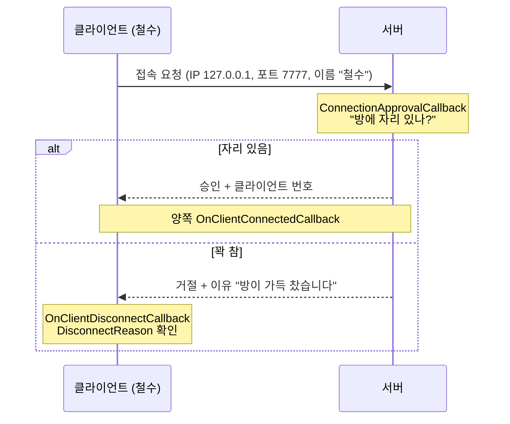
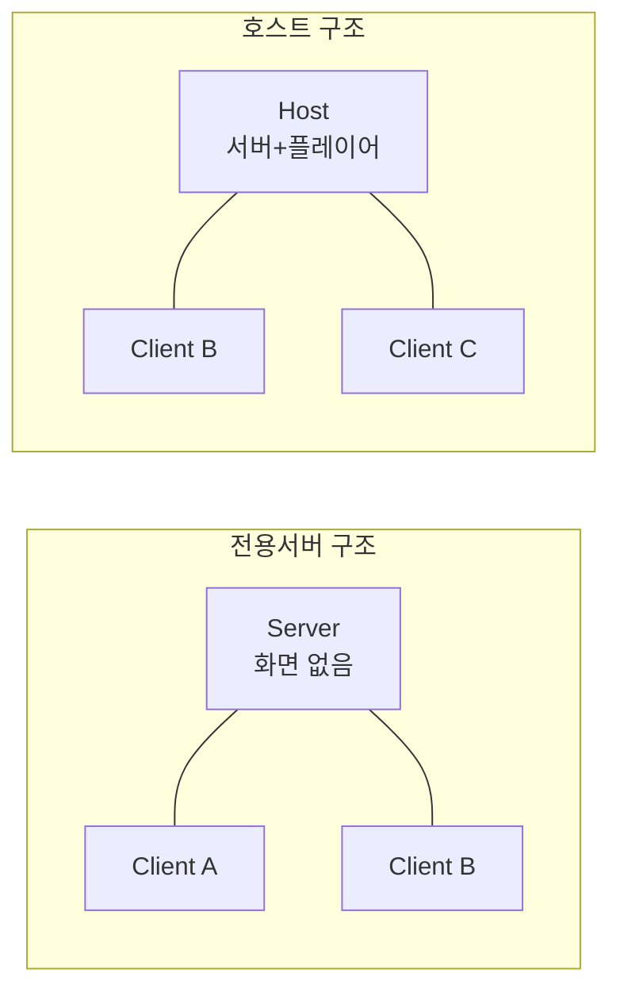

# 01. 접속하기 — Host · Server · Client

> 코드 위치: `git checkout ch01` → `Assets/_Lesson/Scripts/Ch01_Connection/`
> 이 장이 끝나면: 두 개의 게임 창이 서로 "연결됐다"는 것을 로그로 확인할 수 있습니다. 아직 캐릭터는 없습니다.

## 1. 이 장에서 이해할 네트워크 개념

### 1-1. 접속은 "전화 걸기"와 같다



- **IP 주소** = 건물 주소, **포트** = 그 건물의 호실 번호입니다. 같은 컴퓨터에서 테스트할 때는 "나 자신"을 뜻하는 `127.0.0.1`(localhost)을 씁니다.
- 서버는 `0.0.0.0` 에서 기다립니다. "이 컴퓨터의 모든 네트워크 카드로 오는 요청을 받겠다"는 뜻이라, 같은 공유기에 있는 다른 PC도 서버 PC의 내부 IP(예: `192.168.0.10`)로 들어올 수 있습니다.
- 접속 요청에는 작은 데이터를 실어 보낼 수 있습니다(`ConnectionData`). 여기서는 **이름**을 보냅니다. 비밀번호, 게임 버전 확인에도 이 방법을 씁니다.

### 1-2. 세 가지 역할

| 역할 | 하는 일 | `IsServer` | `IsClient` | `IsHost` |
|---|---|---|---|---|
| **Server** | 게임의 "진짜 상태"를 가진 심판. 화면 없이 돌릴 수도 있음 (전용 서버) | ✅ | ❌ | ❌ |
| **Host** | 서버 + 플레이어 한 명을 한 프로그램에서 (리슨 서버) | ✅ | ✅ | ✅ |
| **Client** | 서버에 접속하는 플레이어 | ❌ | ✅ | ❌ |



> 💡 Host 는 서버 역할을 하면서 동시에 게임도 합니다. 그래서 Host 플레이어는 **지연이 0** 이고, 다른 사람은 지연이 있습니다. 공정성이 중요한 게임은 전용 서버를 씁니다.

### 1-3. 클라이언트 번호(ClientId)

- 서버는 접속한 순서대로 번호를 붙입니다. 서버(또는 Host) 자신은 항상 `0` 입니다 (`NetworkManager.ServerClientId`).
- 이 번호는 앞으로 "이 캐릭터의 주인은 누구?"(소유권, 2장)를 판단하는 기준이 됩니다.

## 2. 코드 따라 읽기

### NetworkManager (씬에 하나)
`Assets/_Lesson/Editor/LessonSceneBuilder.cs` 가 씬을 어떻게 만드는지 보세요.

```csharp
var net = netGo.AddComponent<NetworkManager>();
var transport = netGo.AddComponent<UnityTransport>(); // 실제로 UDP 패킷을 주고받는 부품
net.NetworkConfig.NetworkTransport = transport;
net.NetworkConfig.ConnectionApproval = true; // 접속 승인 콜백 사용
net.NetworkConfig.TickRate = 30;             // 1초에 30번 상태를 주고받음
```

- **NetworkManager**: 네트워크 본부. 시작/종료, 접속자 목록, 오브젝트 생성 관리.
- **UnityTransport**: 실제 우편배달부. UDP 위에 "꼭 도착 보장" 같은 기능을 얹어 패킷을 보냅니다.

### ConnectionHud.cs — 시작하기

```csharp
transport.SetConnectionData(address, portNumber, "0.0.0.0");
m_Net.NetworkConfig.ConnectionData = Encoding.UTF8.GetBytes(playerName);

bool ok = mode switch
{
    "host" => m_Net.StartHost(),
    "server" => m_Net.StartServer(),
    _ => m_Net.StartClient(),
};
```

### ConnectionHud.cs — 서버의 접속 승인

```csharp
void ApproveConnection(NetworkManager.ConnectionApprovalRequest request,
                       NetworkManager.ConnectionApprovalResponse response)
{
    string requestedName = Encoding.UTF8.GetString(request.Payload);
    bool full = m_Net.ConnectedClientsIds.Count >= maxPlayers;
    response.Approved = !full;
    response.Reason = full ? $"방이 가득 찼습니다 (최대 {maxPlayers}명)" : null;
    response.CreatePlayerObject = m_Net.NetworkConfig.PlayerPrefab != null;
    ...
}
```

- 이 함수는 **서버에서만** 실행됩니다. 클라이언트가 보낸 데이터는 `request.Payload` 에 바이트로 들어옵니다.
- 서버가 받은 이름은 `ApprovedNames` 표에 저장해 두었다가 4장에서 머리 위 이름표에 씁니다.

### 이벤트 순서

| 이벤트 | 어디서 불리나 | 언제 |
|---|---|---|
| `OnServerStarted` | 서버/Host | 서버가 포트를 열었을 때 |
| `ConnectionApprovalCallback` | 서버/Host | 누군가 접속을 요청했을 때 (Host 자신 포함) |
| `OnClientConnectedCallback` | 서버 + 해당 클라이언트 | 승인 후 연결 완료 |
| `OnClientDisconnectCallback` | 서버 + 해당 클라이언트 | 나가거나, 거절되거나, 시간 초과 |
| `OnTransportFailure` | 양쪽 | 전송 계층 자체 오류 |

### CommandLineStarter.cs — 버튼 없이 시작
빌드한 실행 파일을 옵션으로 시작합니다. 전용 서버를 화면 없이 띄울 때 쓰는 방식입니다.

```text
UnityNetworkLesson.exe -mode server -port 7777 -batchmode -nographics
UnityNetworkLesson.exe -mode client -ip 127.0.0.1 -name 철수
```

## 3. 실행해 보기

**방법 A — 에디터 하나로 여러 플레이어 (Multiplayer Play Mode)**
1. `Assets/_Lesson/Scenes/Main.unity` 를 엽니다.
2. 메뉴 `Window ▸ Multiplayer ▸ Multiplayer Play Mode` 에서 Player 2 를 켭니다.
3. ▶ Play. 메인 에디터에서 **Host**, Player 2 창에서 **Client** 를 누릅니다.

**방법 B — 실행 파일 여러 개**
```powershell
powershell -ExecutionPolicy Bypass -File Tools/build.ps1
powershell -ExecutionPolicy Bypass -File Tools/launch-test.ps1            # 창 3개
powershell -ExecutionPolicy Bypass -File Tools/launch-test.ps1 -Headless -Seconds 10   # 화면 없이 로그만
```

## 4. 직접 해 볼 것

1. `maxPlayers` 를 `2` 로 바꾸고 Host + Client 2개를 띄워 보세요. 세 번째는 어떤 메시지를 받나요?
2. 서버를 켜지 않고 Client 만 눌러 보세요. 몇 초 뒤 어떤 이벤트가 오나요? (연결 시간 초과)
3. Host 를 끄면(Shutdown) Client 쪽 로그는 어떻게 되나요?
4. 같은 공유기의 다른 PC 에서 서버 PC 의 내부 IP 로 접속해 보세요. 안 되면 Windows 방화벽에서 UDP 7777 을 허용해야 합니다.

## 5. 정리

- 네트워크 게임은 **주소(IP) + 포트** 로 서로를 찾고, **서버가 접속을 승인**합니다.
- 역할은 Server / Host / Client 셋이고, `IsServer`, `IsClient`, `IsHost` 로 지금 내가 누구인지 확인합니다.
- 접속 요청에 데이터를 실어 보낼 수 있고(`ConnectionData`), 거절 이유를 돌려줄 수 있습니다(`DisconnectReason`).

<details><summary>퀴즈: Host 로 시작한 프로그램에서 ConnectionApprovalCallback 은 몇 번 불릴까요? (나 혼자일 때)</summary>

1번. Host 는 서버이면서 클라이언트이기도 해서 **자기 자신의 접속**도 승인 과정을 거칩니다.
</details>

<details><summary>퀴즈: 클라이언트 PC 에서 ConnectionApprovalCallback 을 바꾸면 접속 규칙을 우회할 수 있을까요?</summary>

아니요. 승인은 **서버에서만** 실행됩니다. 클라이언트가 자기 코드를 고쳐도 서버의 판단은 바뀌지 않습니다. 이것이 "서버 권한(Server Authority)"의 첫 번째 예입니다.
</details>

➡️ 다음: [02. 플레이어 생성과 이동 동기화](02-player-sync.md)
