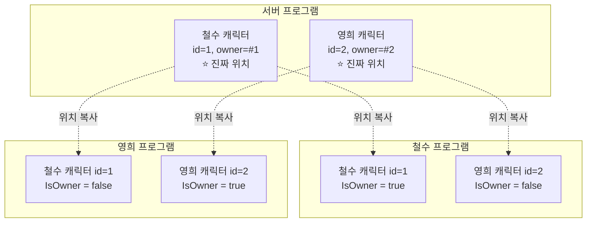
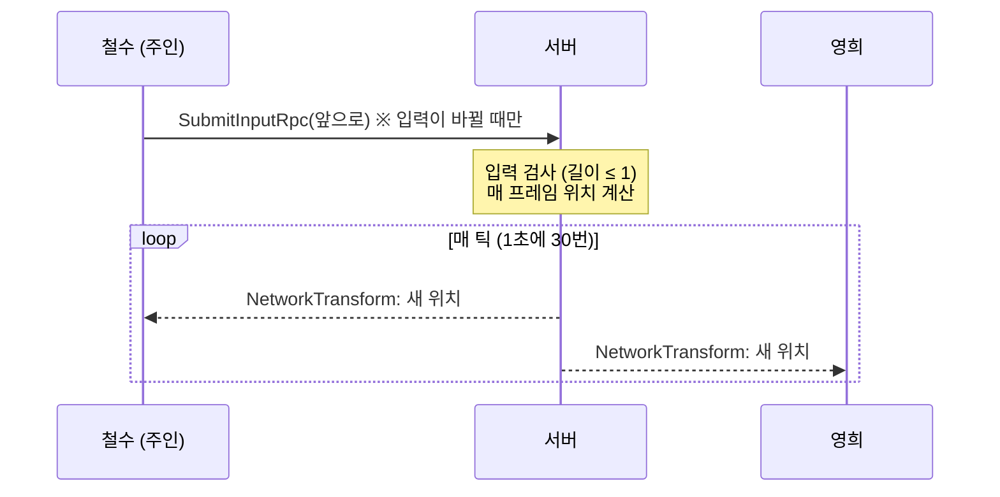

# 02. 플레이어 생성과 이동 동기화 — 소유권과 서버 권한

> 코드 위치: `git checkout ch02` → `Assets/_Lesson/Scripts/Ch02_Player/`
> 이 장이 끝나면: 접속한 사람마다 캡슐 캐릭터가 생기고, WASD 로 움직이면 다른 창에서도 같이 움직입니다.

## 1. 이 장에서 이해할 네트워크 개념

### 1-1. "같은 캐릭터"가 사실은 여러 개다

창이 3개(서버, 철수, 영희)면 철수의 캐릭터는 **세 프로그램에 각각 하나씩, 총 3개의 복사본**이 있습니다.
이 복사본들이 "같은 캐릭터"라는 것을 알려 주는 신분증이 **NetworkObject** 이고, 그 번호가 `NetworkObjectId` 입니다.



### 1-2. 소유권(Ownership)과 권한(Authority)은 다르다

- **소유권(Owner)**: "이 캐릭터는 누구 것인가". 철수 캐릭터의 주인은 철수(#1). `IsOwner` 로 확인합니다.
  - 주인만 그 캐릭터의 **입력**을 보낼 수 있게 합니다.
- **권한(Authority)**: "이 캐릭터의 **진짜 위치를 누가 결정**하는가".
  - 이 교안은 **서버 권한** 방식입니다. 주인도 위치를 직접 바꾸지 못하고, "앞으로 가고 싶어요"라는 **입력만** 보냅니다.

| 방식 | 위치를 정하는 쪽 | 장점 | 단점 |
|---|---|---|---|
| **서버 권한** (이 장) | 서버 | 핵 방지, 모두 같은 결과 | 내 캐릭터도 서버 왕복만큼 늦게 반응 |
| **주인(클라이언트) 권한** | 주인 클라이언트 | 내 캐릭터가 즉시 반응 | 클라이언트가 위치를 조작할 수 있음 (순간이동 핵) |

> NGO 에서는 `NetworkTransform` 의 **Authority Mode** 를 `Server` / `Owner` 로 바꿔 두 방식을 고를 수 있습니다.

### 1-3. 한 번의 이동이 일어나는 과정



- 입력은 **바뀔 때만** 보냅니다. 키를 누르고 있는 동안 같은 값을 계속 보낼 필요가 없습니다.
- 위치는 매 프레임이 아니라 **틱(tick)마다** 보냅니다(이 프로젝트는 30Hz). 그 사이는 받는 쪽이 부드럽게 채웁니다(**보간**, 5장).

### 1-4. 보내지 않아도 되는 것은 보내지 않는다

- 캐릭터 **색깔**은 동기화하지 않습니다. 모두가 아는 `OwnerClientId` 로 각자 계산하면 결과가 같기 때문입니다.
- 바닥을 걷는 게임이므로 `NetworkTransform` 에서 **높이(Y), X·Z 회전, 크기**는 끕니다. 보내는 데이터가 줄어듭니다.

## 2. 코드 따라 읽기

### 플레이어 프리팹 (`LessonSceneBuilder.CreatePlayerPrefab`)

```csharp
go.AddComponent<NetworkObject>();          // 네트워크 신분증
var nt = go.AddComponent<NetworkTransform>();
nt.AuthorityMode = NetworkTransform.AuthorityModes.Server;
nt.SyncPositionY = false; nt.SyncRotAngleX = false; nt.SyncRotAngleZ = false;
go.AddComponent<PlayerMovement>();
go.AddComponent<PlayerLabel>();
```

`NetworkManager` 의 **Player Prefab** 에 이 프리팹을 넣으면, 접속이 승인될 때 서버가 그 클라이언트 소유의 캐릭터를 **Spawn** 합니다 (1장의 `response.CreatePlayerObject`).

### PlayerMovement.cs

```csharp
public override void OnNetworkSpawn()
{
    if (IsServer) transform.position = SpawnPoint(OwnerClientId); // 시작 위치는 서버가
    GetComponent<Renderer>().material.color = ColorFor(OwnerClientId); // 각자 계산
}
```

- `Start()` 대신 **`OnNetworkSpawn()`** 을 씁니다. 이때는 `IsOwner`, `IsServer`, `OwnerClientId` 같은 네트워크 정보가 이미 채워져 있습니다.

```csharp
if (IsOwner)   // ① 주인: 입력만 보낸다
{
    Vector2 input = LessonInput.Move();
    if (input != m_LastSentInput) { m_LastSentInput = input; SubmitInputRpc(input); }
}
if (IsServer)  // ② 서버: 진짜 위치를 계산한다
{
    var pos = transform.position + move * (speed * Time.deltaTime);
    pos.x = Mathf.Clamp(pos.x, -ArenaHalfSize, ArenaHalfSize);
    ...
}
```

```csharp
[Rpc(SendTo.Server, InvokePermission = RpcInvokePermission.Owner)]
void SubmitInputRpc(Vector2 input)
{
    m_ServerInput = Vector2.ClampMagnitude(input, 1f); // 클라이언트를 믿지 않는다
}
```

- **RPC(Remote Procedure Call)** = "다른 컴퓨터에 있는 함수를 호출". 철수 PC 에서 호출하면 **서버 PC 에서 실행**됩니다. 자세한 내용은 3장.
- `InvokePermission = Owner` → 주인이 아닌 사람이 호출하면 서버가 무시합니다.
- `ClampMagnitude` → 조작된 클라이언트가 `(100, 0)` 같은 입력을 보내도 속도가 빨라지지 않습니다.

### Host 일 때는?
Host 는 서버이자 주인이라 `IsOwner` 와 `IsServer` 가 **둘 다 true** 입니다. RPC 도 자기 자신에게 바로 실행되므로 Host 플레이어는 지연이 없습니다.

## 3. 실행해 보기

1. Multiplayer Play Mode 로 Host + Client 를 띄우고 각각 WASD 로 움직여 보세요. 머리 위 `(나)` 표시가 내 캐릭터입니다.
2. **F1** 을 누르면 "내 프로그램에 보이는 네트워크 오브젝트"가 로그에 찍힙니다. 창마다 눌러 보고 `id` 와 `owner` 가 같은지 비교해 보세요.
3. 자동 테스트: 클라이언트가 원을 그리며 걷고, 모든 창이 2초마다 위치를 기록합니다.
   ```powershell
   powershell -ExecutionPolicy Bypass -File Tools/launch-test.ps1 -Headless -Bot -Seconds 10
   ```
   `Builds/testlogs/*.log` 에서 같은 `id` 의 위치가 창마다 거의 같은지 확인하세요.

## 4. 직접 해 볼 것

1. `PlayerMovement.Update()` 의 `if (IsOwner)` 를 지우고 실행해 보세요. 무슨 일이 생기나요? (내 키보드 입력이 **모든 캐릭터** 이름으로 서버에 가지만, 서버는 `InvokePermission = Owner` 때문에 주인이 아닌 요청을 버립니다. 서버 콘솔 로그를 확인해 보세요.)
2. 클라이언트에서 `transform.position` 을 직접 바꿔 보세요(예: `if (IsOwner) transform.position += Vector3.forward;`). 다른 창에서도 보이나요? 왜 서버가 되돌려 놓을까요?
3. `NetworkTransform.AuthorityMode` 를 `Owner` 로 바꾸고, 주인이 직접 위치를 움직이도록 고쳐 보세요. 반응은 빨라지지만 무엇을 잃었나요?
4. `SyncPositionY` 를 다시 켜고 캐릭터를 점프시켜 보세요.

## 5. 정리

- 같은 캐릭터가 **프로그램마다 복사본**으로 존재하고, `NetworkObject` 가 그것을 하나로 묶습니다.
- **주인(Owner)** 은 입력을 보내고, **서버(Authority)** 가 진짜 결과를 정합니다.
- `NetworkTransform` 은 권한을 가진 쪽의 위치를 **틱마다** 나머지에게 복사합니다.
- 네트워크 데이터는 **바뀔 때만, 필요한 것만** 보냅니다.

<details><summary>퀴즈: 서버 권한 방식에서 지연(ping)이 200ms 이면, 철수가 키를 누르고 자기 캐릭터가 움직이는 걸 보기까지 대략 얼마나 걸릴까요?</summary>

약 200ms(왕복). 입력이 서버까지 가는 데 절반, 서버가 계산한 위치가 돌아오는 데 절반이 걸립니다. 여기에 틱 간격과 보간 지연이 조금 더해집니다. 5장의 **클라이언트 예측**이 이 문제를 해결합니다.
</details>

<details><summary>퀴즈: 캐릭터 색깔을 NetworkVariable 로 동기화하지 않아도 되는 이유는?</summary>

모든 프로그램이 같은 `OwnerClientId` 를 알고 있고, 같은 공식(`ColorFor`)으로 계산하면 같은 색이 나오기 때문입니다. "이미 공유된 정보로 계산 가능한 것"은 보낼 필요가 없습니다.
</details>

⬅️ 이전: [01. 접속하기](01-connection.md) · ➡️ 다음: [03. RPC — 공격과 채팅](03-rpc.md)
