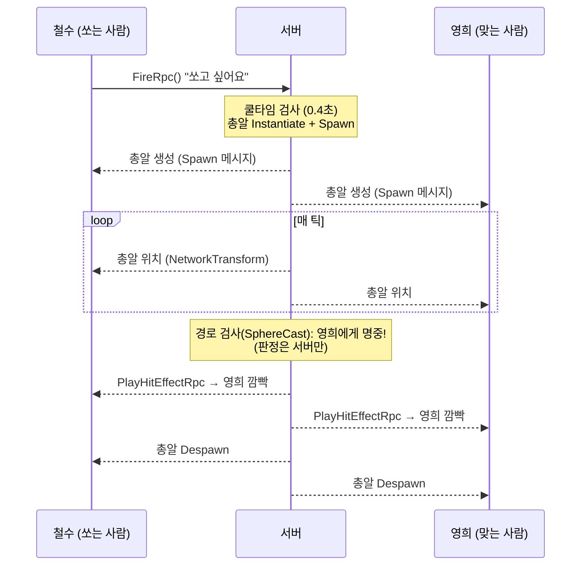

# 03. RPC — 공격과 채팅

> 코드 위치: `git checkout ch03` → `Assets/_Lesson/Scripts/Ch03_Rpc/`
> 이 장이 끝나면: 스페이스바로 총알을 쏘고, 맞으면 하얗게 깜빡이며, 채팅으로 대화할 수 있습니다.

## 1. 이 장에서 이해할 네트워크 개념

### 1-1. RPC = "저쪽 컴퓨터의 함수를 부르는 것"

**RPC(Remote Procedure Call)** 는 내 컴퓨터에서 함수를 호출하면, **다른 컴퓨터에서 그 함수가 실행**되는 기능입니다.
NGO 에서는 함수 이름이 `Rpc` 로 끝나고, `[Rpc(SendTo.누구)]` 를 붙입니다.

| `SendTo` | 실행되는 곳 | 이 프로젝트 예 |
|---|---|---|
| `Server` | 서버 | `FireRpc`, `SendChatRpc`, `SubmitInputRpc`(2장) |
| `ClientsAndHost` | 모든 클라이언트 (Host 포함) | `PlayHitEffectRpc`, `ReceiveChatRpc` |
| `Owner` | 이 오브젝트의 주인 | (예: "너만 볼 수 있는 알림") |
| `NotServer`, `NotOwner`, `Everyone`… | 이름 그대로 | |

### 1-2. RPC 는 "사건"이다

RPC 는 **한 번 일어나고 끝나는 일**에 씁니다: 총 쏘기, 맞음 연출, 채팅 한 줄, 효과음.

> ⚠️ RPC 는 **보낸 순간 접속해 있던 사람**만 받습니다. 채팅 후에 들어온 사람은 이전 대화를 볼 수 없습니다.
> "지금 체력이 몇인가" 같은 **계속 유지되는 상태**는 RPC 가 아니라 **NetworkVariable**(4장)로 보내야 합니다.

### 1-3. 총 한 발이 처리되는 과정



핵심 원칙: **클라이언트는 "요청"만, 서버가 "판단"**.
- 쿨타임 검사, 명중 판정, 자기 총알 무시 — 전부 서버에서 합니다.
- 클라이언트 프로그램을 고쳐도(연사 핵) 서버가 무시하므로 효과가 없습니다.

### 1-4. Spawn / Despawn — 네트워크 오브젝트의 탄생과 죽음

- `Instantiate` 만 하면 **서버에만** 총알이 생깁니다. `NetworkObject.Spawn()` 을 해야 모든 클라이언트에 복사본이 생깁니다.
- 지울 때도 `Destroy` 가 아니라 서버에서 `NetworkObject.Despawn()` 을 해야 모두에게서 사라집니다.
- Spawn 할 수 있는 프리팹은 **서버와 클라이언트가 같은 목록**(`DefaultNetworkPrefabs`)에 갖고 있어야 합니다. 클라이언트는 "프리팹 번호 X 를 만들어라"라는 메시지만 받기 때문입니다.

### 1-5. 씬에 미리 놓인 네트워크 오브젝트

채팅(`Chat`)은 프리팹이 아니라 **씬에 처음부터 놓인 NetworkObject** 입니다. 서버가 시작되면 자동으로 네트워크에 등록되고, 주인은 서버(#0)입니다.
누구의 것도 아닌 "공용 시스템"(채팅, 점수판, 게임 타이머)에 이 방식을 씁니다.

### 1-6. 실제 로그로 보는 "보이는 위치의 차이"

`-report` 로 같은 순간의 총알 위치를 찍어 보면:

```text
서버     : Projectile(id=4) @ (2.6, 1.0, 13.0)
클라이언트: Projectile(id=4) @ (2.4, 1.0, 10.1)
```

클라이언트의 총알이 서버보다 약 **3m 뒤**에 있습니다. 총알 속도가 14m/s 이므로 약 **0.2초 과거**를 보고 있는 셈입니다.
원인은 (1) 전송 지연 + (2) 틱 간격 + (3) 부드럽게 보이려고 일부러 늦게 그리는 **보간(interpolation) 지연**입니다. → 5장

## 2. 코드 따라 읽기

### PlayerCombat.cs — 쏘기

```csharp
void Update()
{
    if (IsSpawned && IsOwner && LessonInput.Fire()) FireRpc(); // 주인만 쏠 수 있다
}

[Rpc(SendTo.Server, InvokePermission = RpcInvokePermission.Owner)]
void FireRpc()
{
    if (Time.time < m_NextFireTime) return;            // 서버가 쿨타임 검사
    m_NextFireTime = Time.time + fireCooldown;
    var projectile = Instantiate(projectilePrefab, spawnPos, transform.rotation);
    projectile.GetComponent<Projectile>().ShooterClientId = OwnerClientId;
    projectile.Spawn(true);                            // 모두에게 생성
}
```

### Projectile.cs — 서버만 움직이고 판정

```csharp
void Update()
{
    if (!IsServer || !IsSpawned) return;   // 움직임과 판정은 서버만
    float step = speed * Time.deltaTime;
    // 이번 프레임에 지나갈 길 전체를 검사 (sweep)
    var hits = Physics.SphereCastAll(transform.position, Radius, transform.forward, step, ~0, QueryTriggerInteraction.Ignore);
    ... 가장 가까운, 쏜 사람이 아닌 PlayerCombat 을 찾으면 Hit(target)
    transform.position += transform.forward * step;
}

void Hit(PlayerCombat target)
{
    target.PlayHitEffectRpc();             // 사건을 모두에게 알림
    NetworkObject.Despawn();
}
```

- 같은 코드가 모든 프로그램에서 돌기 때문에, **"이 줄은 누가 실행해야 하나?"** 를 항상 `IsServer` / `IsOwner` 로 구분합니다.
- 충돌을 "도착한 자리"에서만 보면, 서버가 한 프레임 0.1초 멈췄을 때 총알이 1.4m 를 건너뛰어 캐릭터를 **뚫고 지나갈** 수 있습니다. 그래서 이동할 경로 전체를 `SphereCast` 로 검사합니다. (7장)

### PlayHitEffectRpc — "누가 받나"와 "누가 보낼 수 있나"는 다르다

```csharp
[Rpc(SendTo.ClientsAndHost, InvokePermission = RpcInvokePermission.Server)]
public void PlayHitEffectRpc() { ... }
```

`SendTo` 는 **받는 사람**만 정합니다. 기본 권한은 `Everyone` 이라서, `InvokePermission = Server` 를 빼먹으면 조작된 클라이언트가 이 RPC 를 직접 호출해 **가짜 피격 연출을 모두에게 뿌릴 수** 있습니다. 서버 → 모두 방향의 RPC 에는 항상 `Server` 권한을 붙이세요.

### ChatSystem.cs — 보낸 사람은 서버가 붙인다

```csharp
[Rpc(SendTo.Server)]
void SendChatRpc(string text, RpcParams rpcParams = default)
{
    ulong sender = rpcParams.Receive.SenderClientId;  // NGO 가 알려 주는 진짜 보낸 사람
    string name = ConnectionHud.ApprovedNames[sender]; // 1장에서 접속할 때 저장한 이름
    ReceiveChatRpc($"{name}: {text}");
}

[Rpc(SendTo.ClientsAndHost, InvokePermission = RpcInvokePermission.Server)] // 서버만 뿌릴 수 있다
void ReceiveChatRpc(string line) { m_Lines.Add(line); }
```

- 클라이언트가 `"영희: 바보"` 라고 보내도 앞에 그 **연결의 이름** `"철수: "` 가 붙습니다. 다른 접속자 명의로 보낼 수 없습니다.
- 단, 이름 자체는 접속할 때 클라이언트가 고른 값입니다. 진짜 신원 확인(로그인)이 아니므로, 서버는 겹치는 이름에 번호를 붙여 구분만 합니다(`ConnectionHud.ApproveConnection`).
- `RpcParams` 를 마지막 인자로 넣으면 보낸 사람 같은 부가 정보를 받을 수 있습니다.
- 채팅 오브젝트의 주인은 서버이므로, 기본 권한(`Everyone`)으로 둬야 모든 클라이언트가 호출할 수 있습니다.

## 3. 실행해 보기

1. Host + Client 2개. 스페이스바로 쏴서 상대를 맞혀 보세요. 맞은 캐릭터가 **모든 창에서** 깜빡입니다.
2. 오른쪽 아래 채팅창에 글을 쓰고 Enter.
3. 채팅을 몇 줄 주고받은 뒤 **새 Client 를 하나 더** 접속시켜 보세요. 새 사람의 채팅창은 비어 있습니다 (RPC 의 한계).
4. 자동 테스트: `Tools/launch-test.ps1 -Headless -Bot -Seconds 10` → 서버 로그에 `채팅`, `명중!` 이 찍힙니다.

## 4. 직접 해 볼 것

1. `FireRpc` 의 쿨타임 검사를 클라이언트 쪽 `Update` 로 옮기면 어떤 문제가 생길까요?
2. `PlayHitEffectRpc` 를 `SendTo.Owner` 로 바꾸면? (맞은 사람만 깜빡임을 봅니다)
3. 총알을 NetworkObject 로 만들지 않고, `FireRpc` → `ShootEffectRpc(위치, 방향)` 로 **각 클라이언트가 자기 총알을 그리게** 바꿔 보세요. 네트워크 사용량은 줄지만 판정은 어떻게 할까요?
4. `ReceiveChatRpc` 에 `[Rpc(SendTo.ClientsAndHost, Delivery = RpcDelivery.Unreliable)]` 를 주면? 채팅에 적합한가요?

## 5. 정리

- RPC 는 **원격 함수 호출**, 한 번 일어나는 **사건**에 씁니다. 늦게 들어온 사람은 못 받습니다.
- 클라이언트 → 서버 RPC 는 **요청**, 서버가 **검사하고 결정**합니다.
- 네트워크 오브젝트는 서버가 `Spawn` / `Despawn` 해야 모두에게 생기고 사라집니다.
- 내가 보는 다른 오브젝트는 항상 **조금 과거의 모습**입니다.

<details><summary>퀴즈: 체력을 RPC("체력이 70이 됐어요")로만 알리면 어떤 문제가 생길까요?</summary>

(1) 나중에 들어온 사람은 현재 체력을 모릅니다. (2) 신뢰성 없는 전송이면 한 번 놓친 값을 다시 받을 기회가 없습니다. 상태는 NetworkVariable 로 보내야 합니다 → 4장.
</details>

<details><summary>퀴즈: 왜 채팅 메시지에 붙는 이름을 클라이언트가 아니라 서버가 붙일까요?</summary>

클라이언트는 조작될 수 있기 때문입니다. 서버는 `SenderClientId` 로 **어느 연결이 보냈는지** 알고 있으므로, 다른 접속자 명의로 보내는 것을 막을 수 있습니다. (이름이 진짜 그 사람인지 확인하려면 6장 같은 로그인 서비스가 필요합니다.)
</details>

⬅️ 이전: [02. 플레이어 생성과 이동 동기화](02-player-sync.md) · ➡️ 다음: [04. NetworkVariable — 체력과 이름](04-network-variable.md)
