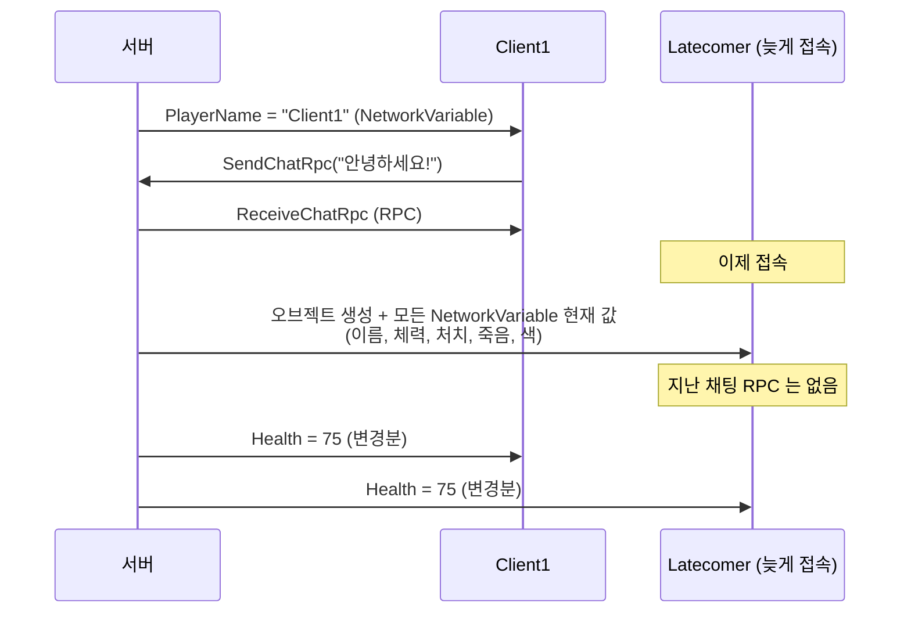

# 04. NetworkVariable — 체력, 이름, 처치 수

> 코드 위치: `git checkout ch04` → `Assets/_Lesson/Scripts/Ch04_NetworkVariable/PlayerStats.cs`
> 이 장이 끝나면: 머리 위에 이름·체력·처치 수가 보이고, 4대 맞으면 죽었다가 3초 뒤 부활합니다. C 키로 색을 바꿉니다.

## 1. 이 장에서 이해할 네트워크 개념

### 1-1. 사건(Event) vs 상태(State)

| | **RPC** (3장) | **NetworkVariable** (이 장) |
|---|---|---|
| 비유 | 확성기 방송 "철수가 맞았다!" | 게시판에 붙은 숫자 "철수 HP: 75" |
| 언제 | 한 번 일어나고 끝나는 일 | 계속 유지되는 값 |
| 늦게 들어온 사람 | ❌ 지난 방송은 못 들음 | ✅ 들어오자마자 게시판의 현재 값을 봄 |
| 보내는 시점 | 호출할 때 즉시 | 값이 바뀐 뒤 다음 틱에 (변경분만) |
| 예 | 발사, 피격 연출, 채팅, 효과음 | 체력, 이름, 점수, 죽음 여부, 팀, 색 |

### 1-2. 실제 테스트 로그로 확인하기

Client1, Client2 가 먼저 들어와 채팅을 하고, 9초 뒤 `Latecomer` 가 들어왔을 때 **Latecomer 의 로그**:

```text
#1 'Client1' 받은 현재 값: 체력 100, 처치 0, 죽음 False   ← 이름(NetworkVariable)은 받았다
#2 'Client2' 받은 현재 값: 체력 100, 처치 0, 죽음 False
서버에 접속했습니다. 내 번호는 #3
#1 체력 100 → 75
채팅 Latecomer: 안녕하세요!                              ← 그 전의 "Client1: 안녕하세요!" 는 없다 (RPC)
```

- 이름은 Latecomer 가 오기 **전에** 서버가 정해 둔 값인데도 받았습니다 → NetworkVariable 은 **접속 시 현재 값을 동기화**합니다.
- 채팅 두 줄은 Latecomer 가 오기 전에 보낸 RPC 라서 받지 못했습니다.



### 1-3. 쓰기 권한 — 누가 값을 바꿀 수 있나

```csharp
// 기본: 모두 읽기, 서버만 쓰기
public readonly NetworkVariable<int> Health = new(MaxHealth);

// 주인이 쓸 수 있는 변수
public readonly NetworkVariable<int> ColorIndex = new(0,
    NetworkVariableReadPermission.Everyone, NetworkVariableWritePermission.Owner);
```

| 변수 | 쓰기 | 이유 |
|---|---|---|
| `Health`, `Kills`, `IsDead` | 서버 | 판정을 서버가 하므로. 클라이언트가 체력을 고치면 안 된다 |
| `PlayerName` | 서버 | 1장에서 접속할 때 받은 이름을 서버가 넣어 준다 (사칭 방지) |
| `ColorIndex` | 주인 | 게임 결과와 상관없는 "취향". 주인이 직접 바꿔도 문제 없음 |

> 2장에서는 색을 `OwnerClientId` 로 **각자 계산**해서 동기화가 필요 없었습니다. 4장에서 "플레이어가 색을 고른다"는 기능이 생기자 **계산할 수 없는 정보**가 되었고, 그래서 동기화가 필요해졌습니다. 이것이 "무엇을 동기화해야 하는가"의 판단 기준입니다.

### 1-4. OnValueChanged 와 "처음 값" 함정

```csharp
Health.OnValueChanged += OnHealthChanged;   // 값이 "바뀔 때" 불린다

// ⚠️ 이미 있던 값으로는 콜백이 불리지 않는다 → 직접 한 번 적용
ApplyColor();
ApplyDeadVisual(IsDead.Value);
```

늦게 들어온 사람이 "이미 죽어 있는 플레이어"를 볼 때, `OnValueChanged` 만 믿으면 죽은 사람이 서 있는 것처럼 보입니다. **`OnNetworkSpawn` 에서 현재 값을 한 번 적용**하는 습관이 중요합니다.

### 1-5. 대역폭: 바뀐 것만, 틱마다

NetworkVariable 은 값이 바뀌어도 즉시 보내지 않고, **다음 틱에 바뀐 변수만 모아서** 보냅니다. 한 틱 안에 체력이 100→75→50 으로 바뀌면 최종값 50 만 갑니다. 그래서 "매 순간의 사건 기록"이 필요하면 RPC, "최종 상태"면 NetworkVariable 입니다.

## 2. 코드 따라 읽기

### 피격 → 체력 → 죽음 → 부활 (서버)

```csharp
// Projectile.cs
target.PlayHitEffectRpc();                                           // 사건 → RPC
target.GetComponent<PlayerStats>().TakeDamage(Damage, ShooterClientId); // 상태 → NetworkVariable

// PlayerStats.cs (서버에서만)
public void TakeDamage(int amount, ulong attackerClientId)
{
    if (!IsServer || IsDead.Value) return;
    Health.Value = Mathf.Max(0, Health.Value - amount);
    if (Health.Value > 0) return;
    IsDead.Value = true;
    attacker.PlayerObject.GetComponent<PlayerStats>().Kills.Value++;
    StartCoroutine(Respawn());
}

IEnumerator Respawn()
{
    yield return new WaitForSeconds(respawnDelay);
    GetComponent<NetworkTransform>().Teleport(SpawnPoint(OwnerClientId), Quaternion.identity, transform.localScale);
    Health.Value = MaxHealth;
    IsDead.Value = false;
}
```

- `NetworkManager.ConnectedClients[id].PlayerObject` 로 특정 클라이언트의 플레이어 오브젝트를 찾습니다 (서버에서만 사용 가능).
- **`Teleport`**: 그냥 `position` 을 바꾸면 클라이언트는 보간 때문에 맵을 가로질러 **미끄러지는** 모습을 봅니다. Teleport 는 "보간하지 말고 바로 옮겨라"라는 표시를 같이 보냅니다.

### 값 → 화면 (모든 프로그램)

```csharp
void OnDeadChanged(bool previous, bool current) => ApplyDeadVisual(current);

void ApplyDeadVisual(bool dead)
{
    foreach (var r in GetComponentsInChildren<Renderer>()) r.enabled = !dead;
    GetComponent<Collider>().enabled = !dead;
}
```

서버는 "죽었다"는 **사실(IsDead)** 만 정하고, 그걸 **어떻게 보여 줄지**는 각 프로그램이 정합니다. 데이터와 표현을 나누면 보내는 양이 줄고 코드도 단순해집니다.

### 문자열은 FixedString

```csharp
public readonly NetworkVariable<FixedString64Bytes> PlayerName = new();
var fixedName = new FixedString64Bytes();
fixedName.CopyFromTruncated(name); // 너무 길면 잘라서
```

NetworkVariable 에는 `string` 대신 **고정 크기 문자열**(`FixedString32/64/128Bytes`)을 씁니다. 크기가 정해져 있어야 효율적으로 직렬화할 수 있기 때문입니다. 한글은 한 글자가 3바이트라 64Bytes 에 약 20자까지 들어갑니다.

## 3. 실행해 보기

1. Host + Client 2개. 서로 쏴서 체력이 줄고, 0 이 되면 사라졌다가 3초 뒤 부활하는지 보세요.
2. **C 키**로 색을 바꿔 보세요. 다른 창에서도 바뀝니다.
3. 누군가 죽어 있는 동안 **새 Client 를 접속**시켜 보세요. 새 사람 화면에서도 그 플레이어가 숨겨져 있어야 합니다.
4. 자동 테스트 (9초 뒤 한 명 더 접속):
   ```powershell
   powershell -ExecutionPolicy Bypass -File Tools/launch-test.ps1 -Headless -Bot -Seconds 16 -LateJoinAfter 9
   ```
   `Builds/testlogs/late.log` 에서 무엇은 받았고 무엇은 못 받았는지 확인하세요.

## 4. 직접 해 볼 것

1. `OnNetworkSpawn` 의 `ApplyDeadVisual(IsDead.Value);` 를 지우고 3번 실험을 다시 해 보세요.
2. 클라이언트에서 `Health.Value = 999;` 를 실행해 보세요. 어떤 오류가 나나요? (쓰기 권한)
3. 팀(`NetworkVariable<int> Team`)을 추가하고 같은 팀끼리는 피해를 받지 않게 해 보세요. 검사는 어디서 해야 할까요?
4. 점수판 `NetworkList<int>` 를 씬 오브젝트(채팅처럼)에 두고 모든 플레이어의 점수를 표시해 보세요.

## 5. 정리

- **NetworkVariable = 상태**. 바뀐 값을 틱마다 보내고, 늦게 온 사람도 현재 값을 받습니다.
- 쓰기 권한은 기본 **서버**. 결과에 영향 없는 취향 정도만 **Owner** 쓰기를 허용합니다.
- `OnValueChanged` 는 "바뀔 때만" — 접속 시점 값은 `OnNetworkSpawn` 에서 직접 적용.
- 계산으로 알 수 있는 것은 보내지 말고, 계산할 수 없는 것만 동기화합니다.

<details><summary>퀴즈: "총 쏘는 소리"는 RPC 와 NetworkVariable 중 무엇으로 보내야 할까요?</summary>

RPC. 한 번 일어나고 끝나는 사건이고, 늦게 들어온 사람이 지난 총소리를 들을 필요가 없습니다.
</details>

<details><summary>퀴즈: 한 틱 안에 총알 두 발을 맞아 체력이 100→75→50 이 되었습니다. 클라이언트는 75 를 볼 수 있을까요?</summary>

아니요. NetworkVariable 은 틱마다 **최종값**만 보내므로 클라이언트는 100→50 으로 봅니다. 각 피격을 모두 보여 줘야 한다면 피격 사건을 RPC(`PlayHitEffectRpc`)로 따로 보냅니다 — 이 프로젝트가 그렇게 하고 있습니다.
</details>

⬅️ 이전: [03. RPC — 공격과 채팅](03-rpc.md) · ➡️ 다음: [05. 지연과 싸우기 — 보간, 예측, 보정](05-latency.md)
