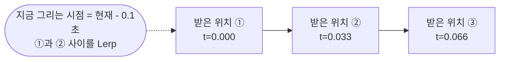
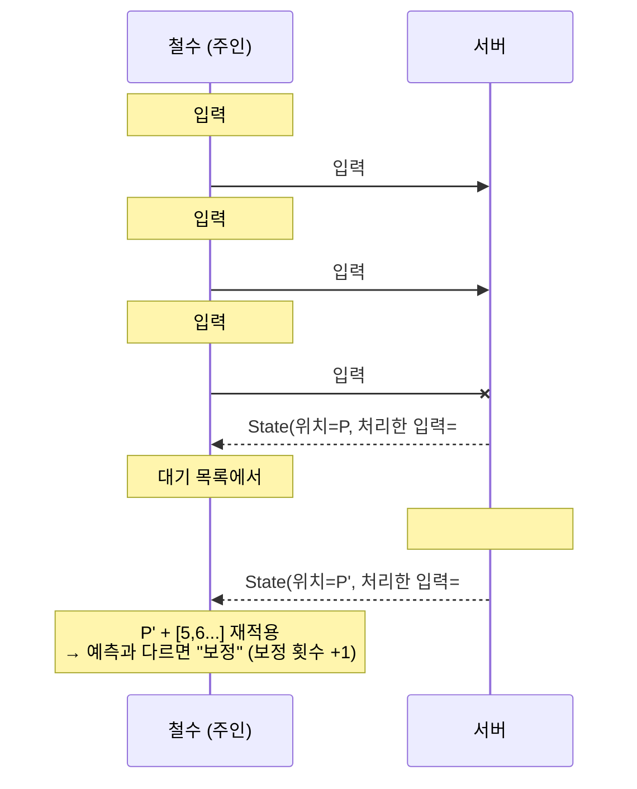

# 05. 지연과 싸우기 — 보간, 예측, 보정

> 코드 위치: `git checkout ch05` → `Assets/_Lesson/Scripts/Ch05_Latency/`
> 이 장이 끝나면: 화면 오른쪽 위 **지연 실험실**에서 지연·손실을 일부러 만들고, 세 가지 기술을 켜고 끄며 차이를 몸으로 느낄 수 있습니다.

## 1. 이 장에서 이해할 네트워크 개념

### 1-1. 문제: 서버 권한 + 지연 = 굼뜬 조작

2장의 방식(입력 → 서버 → 위치)은 공정하지만, **RTT(왕복 시간)** 만큼 내 캐릭터가 늦게 움직입니다.

실제 측정값 (이 프로젝트, 클라이언트에 지연 100ms 설정):

```text
[지연] RTT 216ms, 예측 True, 보정 True, 보정 횟수 7
```

설정은 100ms 인데 RTT 가 약 216ms 인 이유: 시뮬레이터가 **보내는 패킷과 받는 패킷 모두** 100ms 씩 늦추고, 여기에 틱 간격(33ms)만큼 기다리는 시간이 더해지기 때문입니다.

### 1-2. 세 가지 해결 기술

| 기술 | 누구를 위해 | 하는 일 | 대가 |
|---|---|---|---|
| **보간 (Interpolation)** | 남의 캐릭터 | 받은 위치 두 개 사이를 부드럽게 채워 그림 | 일부러 **0.1초 과거**를 보여 줌 |
| **예측 (Prediction)** | 내 캐릭터 | 서버 답을 기다리지 않고 입력 즉시 내 화면에서 움직임 | 서버와 결과가 다를 수 있음 |
| **보정 (Reconciliation)** | 내 캐릭터 | 서버 답이 오면 그 위치에서 **아직 처리 안 된 입력을 다시 적용** | 틀렸을 때 살짝 "튐" |

### 1-3. 보간 — 왜 과거를 보여 줄까?

서버는 1초에 30번(33ms 마다) 위치를 보냅니다. 받은 즉시 그 위치로 옮기면 **뚝뚝 끊깁니다**. 게다가 흔들림(jitter) 때문에 도착 간격도 들쭉날쭉합니다.



"항상 두 점 사이를 그릴 수 있도록" 일부러 0.1초 늦게 그립니다. 3장에서 클라이언트의 총알이 서버보다 3m 뒤에 있던 이유 중 하나가 바로 이것입니다.

### 1-4. 예측 + 보정 — 입력에 번호를 붙인다



핵심 조건: **클라이언트와 서버가 똑같은 이동 공식(`Simulate`)을 써야** 예측이 맞습니다. 그래서 이동은 `Update`(프레임마다 달라지는 deltaTime)가 아니라 **틱마다, 고정된 시간 간격**으로 계산합니다.

### 1-5. 입력은 왜 Unreliable 로 보낼까?

매 틱 새 입력이 가기 때문에, 잃어버린 옛 입력을 **재전송하는 것보다 다음 입력을 보내는 것**이 낫습니다. 재전송을 기다리면 그 뒤 입력까지 줄줄이 늦어집니다(TCP 의 head-of-line blocking 과 같은 문제). 잃어버린 차이는 **보정**이 고칩니다.

손실 5% 테스트에서 3초마다 보정이 2~3번씩 일어났습니다 — 서버가 못 받은 입력만큼 위치가 달라졌고, 클라이언트가 서버 기준으로 고친 것입니다.

### 1-6. 스피드 핵 방지 — 입력 예산

클라이언트가 1틱에 입력을 10개 보내면 서버가 10번 움직여 줄까요? 그러면 10배 빨라집니다. 서버는 **틱마다 입력 1개(여유분 포함 최대 4개)** 만 처리하도록 예산을 둡니다.

## 2. 코드 따라 읽기

### PredictedMovement.cs — 같은 공식

```csharp
Vector3 Simulate(Vector3 position, Vector2 input)
{
    input = Vector2.ClampMagnitude(input, 1f);
    position += new Vector3(input.x, 0, input.y) * (speed * TickDelta); // 고정 간격
    ... 경기장 밖으로 못 나가게 Clamp
    return position;
}
```

### 틱마다 (주인 / 서버)

```csharp
void OnTick()
{
    if (IsOwner)
    {
        int seq = ++m_NextSeq;
        m_Pending.Add(new PendingInput { Seq = seq, Move = input });
        if (LatencyLab.Prediction) m_Predicted = Simulate(m_Predicted, input); // ① 예측
        SubmitInputRpc(seq, input);
    }
    if (IsServer)
    {
        m_State.Value = new MoveState { Position = m_ServerPos, LastProcessedInput = m_LastProcessed };
    }
}

[Rpc(SendTo.Server, InvokePermission = RpcInvokePermission.Owner, Delivery = RpcDelivery.Unreliable)]
void SubmitInputRpc(int seq, Vector2 input)
{
    if (seq <= m_LastProcessed) return;   // 순서가 뒤바뀌어 늦게 온 옛 입력은 버림
    m_LastProcessed = seq;
    if (m_Stats.IsDead.Value || m_InputBudget <= 0) return;
    m_InputBudget--;
    m_ServerPos = Simulate(m_ServerPos, input);
}
```

### 서버 답이 왔을 때

```csharp
// 주인: ② 보정
m_Pending.RemoveAll(p => p.Seq <= current.LastProcessedInput);
var replayed = current.Position;
foreach (var p in m_Pending) replayed = Simulate(replayed, p.Move);
if ((replayed - m_Predicted).sqrMagnitude > 0.0001f) LatencyLab.CorrectionCount++;
m_Predicted = replayed;

// 남들: ③ 보간용으로 쌓기
m_Snapshots.Add((Time.timeAsDouble, current.Position));
```

### 왜 NetworkTransform 을 안 쓰나?

NetworkTransform 은 "위치 복사 + 보간"까지는 해 주지만, **입력 번호를 이용한 예측·보정**은 해 주지 않습니다. 원리를 이해하기 위해 이 장에서는 직접 구현했습니다. 위치는 `NetworkVariable<MoveState>` 로 보냅니다(4장). 총알은 여전히 NetworkTransform 을 쓰며, 지연 실험실의 **보간** 스위치가 총알의 `NetworkTransform.Interpolate` 에도 적용됩니다.

> 실무에서는 NGO 에 맞춘 예측 라이브러리나, 예측을 기본 제공하는 **Netcode for Entities** / Photon Fusion 같은 솔루션을 쓰기도 합니다. 원리는 이 장과 같습니다.

## 3. 실행해 보기

1. Host + Client. **Client 창**의 지연 실험실에서 지연을 150ms 로 올립니다.
2. **예측 끄기** → WASD. 캐릭터가 한 박자 늦게 움직입니다 (2장과 같은 느낌).
3. **예측 켜기** → 즉시 움직입니다. 바닥의 **흰 원판(유령)** 이 서버가 확정한 위치로, 캐릭터보다 약간 뒤따라옵니다.
4. 패킷 손실을 10% 로 올립니다. **보정 끄기** → 캐릭터와 흰 원판이 점점 벌어집니다. **보정 켜기** → 다시 맞춰지고 "보정 횟수"가 올라갑니다.
5. **Host 창**에서 Client 캐릭터를 보며 **보간 끄기/켜기** → 끊김 vs 부드러움.

자동 테스트:
```powershell
powershell -ExecutionPolicy Bypass -File Tools/launch-test.ps1 -Headless -Bot -Seconds 12 -ClientArgs "-lag 100 -loss 5"
powershell -ExecutionPolicy Bypass -File Tools/launch-test.ps1 -Headless -Bot -Seconds 12 -ClientArgs "-lag 100 -loss 5 -noReconcile"
```

## 4. 직접 해 볼 것

1. `LatencyLab.InterpolationDelay` 를 `0.03` 과 `0.3` 으로 바꿔 보세요. 부드러움과 "과거를 보는 정도"는 어떻게 바뀌나요?
2. `Simulate` 에서 서버만 속도를 조금 다르게(예: `speed * 1.1f` 를 서버에서만) 해 보세요. 보정 횟수가 어떻게 되나요? → "같은 공식"이 왜 중요한지 확인
3. 입력 예산(`m_InputBudget`) 검사를 지우고, 주인이 한 틱에 입력을 5번 보내도록 고쳐 보세요 (스피드 핵 체험).
4. **지연 보상(Lag Compensation)** 생각해 보기: 200ms 지연 플레이어가 "화면에서는 맞혔는데" 서버에서는 빗나갑니다. 서버가 "쏜 사람이 보던 0.2초 전 위치"로 되감아 판정하려면 무엇을 저장해야 할까요?

## 5. 정리

- 지연은 없앨 수 없고 **숨길** 뿐입니다.
- **보간**: 남의 캐릭터를 부드럽게, 대신 조금 과거.
- **예측**: 내 캐릭터는 즉시. **보정**: 서버가 진실 — 틀리면 서버 위치 + 미처리 입력 재적용.
- 예측이 맞으려면 **같은 공식, 고정된 틱 간격**. 입력에는 **번호**를 붙인다.
- 계속 새 값이 가는 데이터(입력, 위치)는 **Unreliable** 이 더 낫다.

<details><summary>퀴즈: 예측을 켜면 서버 권한(핵 방지)이 깨질까요?</summary>

아니요. 예측은 **내 화면에서만** 먼저 보여 주는 것이고, 진짜 위치는 여전히 서버가 정합니다. 조작된 클라이언트가 예측 위치를 멋대로 바꿔도 서버 위치는 바뀌지 않고, 다음 보정 때 서버 위치로 되돌아갑니다.
</details>

<details><summary>퀴즈: 남의 캐릭터도 예측하면 안 될까요?</summary>

남의 **입력**을 미리 알 수 없어서 정확한 예측이 어렵습니다. "지금 속도로 계속 간다"고 가정하는 **외삽(extrapolation, dead reckoning)** 을 쓸 수는 있지만, 방향을 바꾸면 크게 틀립니다. 그래서 보통 남의 캐릭터는 보간을 씁니다.
</details>

⬅️ 이전: [04. NetworkVariable](04-network-variable.md) · ➡️ 다음: [06. 인터넷 너머로 — Relay 와 세션](06-relay.md)
