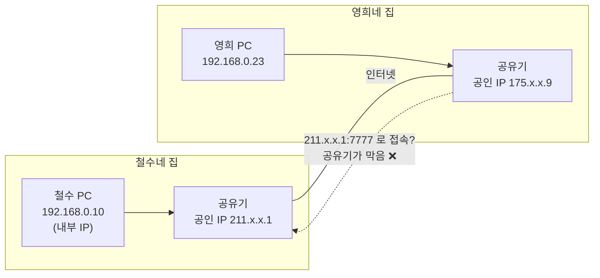
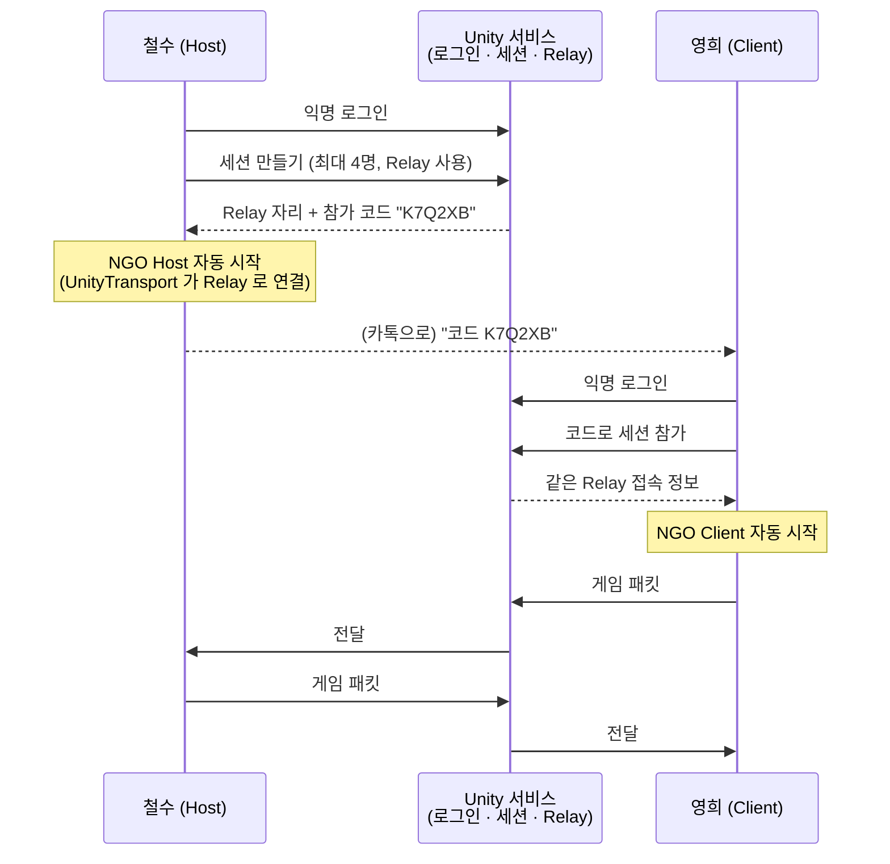

# 06. 인터넷 너머로 — NAT, Relay, 세션(참가 코드)

> 코드 위치: `git checkout ch06` → `Assets/_Lesson/Scripts/Ch06_Relay/SessionHud.cs`
> 이 장이 끝나면: IP 주소 없이 **6자리 참가 코드**만으로 다른 집에 있는 친구와 같이 플레이할 수 있습니다.

## 1. 이 장에서 이해할 네트워크 개념

### 1-1. 왜 1장 방식으로는 친구 집과 연결이 안 될까? — NAT

집 공유기는 PC 여러 대가 **공인 IP 하나를 나눠 쓰게** 해 줍니다(NAT, Network Address Translation).



- 밖에서 들어오는 요청은 공유기가 "어느 PC 로 보내야 하지?" 를 몰라 **버립니다**.
- 해결책 ① **포트포워딩**: 공유기 설정에서 "7777 로 오면 철수 PC 로" — 친구마다 설정하기 번거롭고 위험할 수 있음
- 해결책 ② **NAT 펀칭**: 양쪽이 동시에 밖으로 연결을 시도해 길을 뚫음 — 공유기 종류에 따라 실패
- 해결책 ③ **Relay 서버**: 둘 다 "밖으로 나가는" 연결은 할 수 있으므로, 인터넷에 있는 중계 서버에 각자 접속 → 중계 서버가 패킷을 전달 ✅

### 1-2. Relay 를 거친 연결



- 게임 코드(1~5장)는 **하나도 바뀌지 않습니다**. 바뀌는 것은 "패킷이 어디로 가는가"(UnityTransport 의 목적지) 뿐입니다.
- 대가: 모든 패킷이 중계 서버를 거치므로 **지연이 조금 늘어납니다**. 가까운 지역(region)의 Relay 를 고르는 이유입니다.
- 여전히 Host 구조이므로 **Host 가 나가면 게임이 끝납니다**. (전용 서버를 쓰면 해결 — 7. 더 나아가기)

### 1-3. 세션(Session) = 로비 + Relay + 접속 정보

Unity Multiplayer Services 의 **세션**은 다음을 한 번에 처리합니다.

| 하는 일 | 예전에는 직접 |
|---|---|
| 방 목록/참가 코드 관리 | Lobby 서비스 |
| 중계 서버 자리 예약·접속 정보 교환 | Relay 서비스 |
| NGO Host/Client 시작 | `StartHost()` / `StartClient()` 호출 |

## 2. 사전 준비 (한 번만)

1. Unity 에디터 메뉴 `Edit ▸ Project Settings ▸ Services` 에서 **Unity Cloud 프로젝트에 연결**합니다 (Unity 계정 로그인 필요, 없으면 새로 만들기).
2. [Unity Cloud 대시보드](https://cloud.unity.com) 에서 해당 프로젝트의 **Multiplayer(Relay)** 사용 설정을 확인합니다. Relay 는 무료 사용량이 있는 종량제 서비스입니다. 최신 요금·설정 화면은 대시보드에서 확인하세요.
3. 연결이 안 된 상태에서 버튼을 누르면 화면에 `실패: ...` 메시지가 나옵니다.

## 3. 코드 따라 읽기

### 로그인

```csharp
var options = new InitializationOptions().SetProfile($"p{Random.Range(0, 1_000_000)}");
await UnityServices.InitializeAsync(options);
await AuthenticationService.Instance.SignInAnonymouslyAsync();
```

- 익명 로그인 = 계정 없이 이 기기에 고유한 플레이어 ID 를 발급받습니다.
- 같은 PC 에서 창을 여러 개 띄우면 같은 ID 가 되어 충돌하므로 **프로필**을 창마다 다르게 줍니다.

### 방 만들기 / 참가

```csharp
var options = new SessionOptions { MaxPlayers = maxPlayers }.WithRelayNetwork();
m_Session = await MultiplayerService.Instance.CreateSessionAsync(options);
m_Status = $"방 코드: {m_Session.Code}";

m_Session = await MultiplayerService.Instance.JoinSessionByCodeAsync(m_JoinCode);
```

- `WithRelayNetwork()` 한 줄이 "Relay 로 연결하라"는 뜻입니다.
- 세션이 **NGO 를 대신 시작**하므로, 1장의 이름 전달(`ConnectionData`)은 미리 넣어 둡니다(`PrepareConnectionData`). 그래서 접속 승인, 이름표, 채팅 등 1~5장 기능이 그대로 동작합니다.

### async / await

인터넷 서비스 호출은 시간이 걸리므로 `await` 로 "끝날 때까지 기다리되 게임은 멈추지 않게" 합니다. 실패하면 예외가 나므로 `try/catch` 로 화면에 이유를 보여 줍니다.

## 4. 실행해 보기

1. 사전 준비를 마친 뒤 Play (또는 빌드 실행).
2. 첫 창: **인터넷 방 만들기 (Relay)** → `방 코드: XXXXXX` 확인.
3. 두 번째 창(다른 PC 도 OK): 코드 입력 → **코드로 참가**.
4. 5장 지연 실험실의 RTT 를 1장 방식(127.0.0.1)과 비교해 보세요. Relay 를 거치면 RTT 가 늘어납니다.

## 5. 직접 해 볼 것

1. `SessionOptions` 에 `IsPrivate = false` 와 이름을 주고, `QuerySessionsAsync` 로 **공개 방 목록**을 띄워 보세요.
2. `WithRelayNetwork("asia-northeast3")` 처럼 지역을 지정하면 RTT 가 어떻게 바뀌나요? (지역 이름은 Relay 문서 참고)
3. Host 가 "방 나가기"를 누르면 Client 에게 어떤 이벤트가 오나요? (1장의 `OnClientDisconnectCallback`)

## 6. 정리

- 공유기(NAT) 때문에 인터넷 너머의 PC 에 직접 접속하기 어렵습니다.
- **Relay** 는 양쪽이 밖으로 연결하는 중계 서버를 통해 이 문제를 피합니다. 대신 지연이 조금 늘어납니다.
- **세션**은 참가 코드, Relay 접속 정보 교환, NGO 시작을 묶어 줍니다. 게임 로직은 바뀌지 않습니다.

## 7. 더 나아가기 (이 교안 다음 단계)

| 주제 | 한 줄 설명 |
|---|---|
| 전용 서버 (Dedicated Server) | `-mode server -batchmode -nographics` 로 1장의 서버를 클라우드에 올리기. Host 이탈 문제 해결, 공정성 ↑ |
| 지연 보상 (Lag Compensation) | 서버가 과거 위치를 저장해 두고, 쏜 사람이 보던 시점으로 되감아 판정 |
| 관심 영역 (Interest Management) | 멀리 있는 오브젝트는 안 보내기 — NGO 의 `NetworkObject.CheckObjectVisibility` |
| 씬 전환 | `NetworkManager.SceneManager.LoadScene` 으로 모두 함께 맵 이동 |
| 분산 권한 (Distributed Authority) | NGO 2.x 의 새 구조. 서버 없이 클라이언트들이 오브젝트 권한을 나눠 가짐 |

⬅️ 이전: [05. 지연과 싸우기](05-latency.md) · ➡️ 다음: [07. 코드 리뷰로 배우는 네트워크 보안·정확성](07-code-review.md) · 🏠 [처음으로](../README.md)
