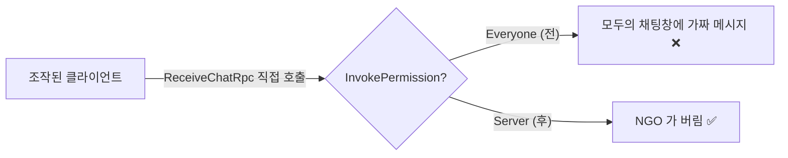
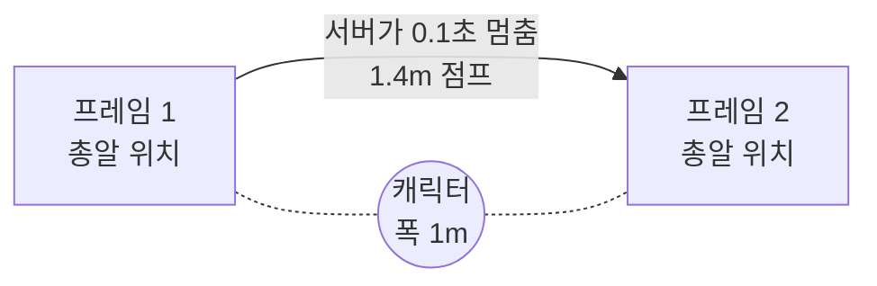

# 07. 코드 리뷰로 배우는 네트워크 보안·정확성

> 코드 위치: `main` 브랜치 (태그 `ch07`). 바뀐 내용 보기: `git diff ch06 ch07`
> 1~6장을 완성한 뒤, 다른 사람(리뷰어)이 코드를 검토해 찾아낸 문제들입니다. 대부분 **"동작은 하는데 틀린"** 문제라 테스트로는 잘 안 보이고, 네트워크 게임에서 실제로 자주 나오는 실수입니다.

## 1. 핵심 교훈 한 줄

> **클라이언트에서 오는 모든 것은 거짓말일 수 있다. 그리고 서버도 "언제", "어디서" 판정하는지 정확해야 한다.**

## 2. 보안: 조작된 클라이언트

### 2-1. `SendTo` 는 받는 사람, `InvokePermission` 은 보낼 수 있는 사람

```csharp
// 전 (3장)                              // 후
[Rpc(SendTo.ClientsAndHost)]              [Rpc(SendTo.ClientsAndHost, InvokePermission = RpcInvokePermission.Server)]
void ReceiveChatRpc(string line)          void ReceiveChatRpc(string line)
```

- NGO RPC 의 기본 권한은 `Everyone` 입니다. 그래서 "서버 → 모두" 용도로 만든 RPC 도 **클라이언트가 직접 호출**할 수 있었습니다.
- 정상 클라이언트는 `SendChatRpc` → 서버 → `ReceiveChatRpc` 순서로만 쓰지만, 조작된 클라이언트는 중간의 서버 검사(이름 붙이기, 길이 제한)를 건너뛰고 `ReceiveChatRpc("관리자: 서버 점검합니다")` 를 모두에게 뿌릴 수 있었습니다.
- `PlayHitEffectRpc`(가짜 피격 연출)도 같은 문제였습니다.



**규칙**: 서버가 부르는 RPC → `Server`, 주인이 부르는 RPC → `Owner`, 정말 누구나 부를 수 있어야 하는 것만 `Everyone`.

### 2-2. 숫자가 아닌 숫자 — NaN

```csharp
if (!float.IsFinite(input.x) || !float.IsFinite(input.y)) return; // 새로 추가
m_ServerInput = Vector2.ClampMagnitude(input, 1f);
```

- `ClampMagnitude` 는 길이 1 이 넘는 입력은 막지만, **NaN(Not a Number)** 은 막지 못합니다. NaN 은 어떤 계산을 해도 NaN 이라, 서버의 진짜 위치가 NaN 이 되고 그 값이 **모든 클라이언트에 퍼집니다**.
- 네트워크로 받은 실수(float)는 항상 "유한한 수인가"부터 검사합니다.

### 2-3. 이름은 신원이 아니다

- 3장 채팅에서 "보낸 사람 이름은 서버가 붙이니 사칭 불가"라고 했지만, 그 이름 자체는 **클라이언트가 접속할 때 고른 값**입니다. 두 사람이 같은 이름으로 들어올 수 있었습니다.
- 서버는 이제 겹치는 이름에 `#번호` 를 붙입니다. 진짜 신원 확인은 로그인(6장의 Authentication 서비스 같은)이 필요합니다.
- `SenderClientId` 가 보장하는 것은 "**어느 연결**이 보냈는가"입니다. "그 사람이 누구인가"가 아닙니다.

## 3. 정확성: 서버 판정의 "언제·어디서"

### 3-1. 총알이 캐릭터를 뚫고 지나간다 — 이산 충돌 vs 연속 충돌



- 3장의 총알은 프레임마다 위치를 옮긴 뒤 "**도착한 자리**"에서만 충돌을 봤습니다(트리거).
- 서버 프레임이 0.1초 늦어지면 총알(14m/s)은 1.4m 를 건너뛰는데, 캐릭터+총알 두께는 약 1.35m 라 **사이에 있던 캐릭터를 통과**할 수 있었습니다.
- 수정: 이동하기 전에 **갈 길 전체**를 `Physics.SphereCastAll` 로 검사하고, 가장 가까운 상대에 명중 처리합니다. 서버는 바쁠 때 프레임이 길어지므로 서버 판정 코드에는 특히 중요합니다.

### 3-2. 부활한 자리에서 맞는 문제

- 서버가 부활 위치를 "다음 Update 에서" 옮기도록 했는데, 그 전에 콜라이더를 다시 켰습니다. 그 사이 물리 판정이 돌면 **죽었던 자리**에 있는 캐릭터가 맞을 수 있었습니다.
- 수정: `ServerTeleport` 에서 실제 `transform.position` 을 **즉시** 옮긴 다음 체력·콜라이더를 복구합니다. → "상태를 바꾸는 순서"도 판정의 일부입니다.

### 3-3. 죽어 있던 동안의 입력이 부활 후에 되살아남

- 5장의 주인 클라이언트는 죽어 있는 동안에도 입력을 대기 목록에 쌓았고, 서버는 그 입력을 무시했습니다. **같은 입력에 대해 클라이언트와 서버의 규칙이 달랐던 것**이라, 부활 뒤 보정(재적용) 때 그 입력들이 다시 적용될 수 있었습니다.
- 수정: (1) 죽어 있으면 입력을 만들지도 보내지도 않음 (2) 순간이동을 받으면 대기 목록을 비움.
- 교훈: 예측이 맞으려면 **공식뿐 아니라 "이 입력을 적용할지 말지"의 규칙도 같아야** 합니다.

### 3-4. 보정 때문에 뒤로 돌아서는 캐릭터

- 5장은 "화면에서 움직인 방향"으로 캐릭터를 회전시켰습니다. 보정으로 위치가 뒤로 살짝 튀면 캐릭터가 **뒤돌았다가** 다시 앞을 봤고, 서버는 그 순간 엉뚱한 방향으로 총을 쏠 수도 있었습니다.
- 수정: 서버와 주인은 **입력 방향**으로 바라봅니다. 보정은 "위치를 고치는 것"이지 "움직인 것"이 아닙니다.

## 4. 사용성: 두 가지 접속 방식이 섞일 때

- 6장 Relay 방을 만드는 중(인터넷 요청을 기다리는 몇 초 동안)에 1장의 Host 버튼을 누를 수 있었습니다. 그러면 NetworkManager 가 이미 켜져 있어 세션이 "성공"으로 보이지만 실제로는 Relay 를 쓰지 않는 상태가 됩니다.
- 수정: 세션 작업 중·세션 안에서는 직접 접속 버튼을 막고, 종료는 "방 나가기"로만.
- 교훈: `async/await` 로 기다리는 동안에도 **화면과 게임은 계속 돈다**. 그 사이에 다른 동작이 끼어들 수 있음을 항상 생각해야 합니다.

## 5. 문서도 리뷰 대상 — 고친 설명들

| 장 | 이전 설명 | 바로잡은 내용 |
|---|---|---|
| 00 | `Reliable` 은 순서 보장이 안 될 수 있다 | 일반론은 맞지만, NGO 의 UnityTransport 는 `Reliable` 을 순서 보장 통로로 보낸다 |
| 02 | `if (IsOwner)` 를 지우면 서버가 요청을 버린다 | 먼저 **보내는 쪽에서 예외**가 난다. 서버 검사는 조작된 클라이언트에 대한 두 번째 방어선 |
| 05 | RTT 216ms 중 일부는 틱 간격 때문 | RTT 는 전송 계층의 패킷 왕복 시간. 틱 대기·보간 지연은 그 위에 따로 더해진다 |
| 05 | 보간 스위치가 총알에도 적용 | NetworkTransform 보간은 서버 쪽 설정이 퍼지므로 플레이어 보간에만 적용 |
| 05 | Host 창에서 보간 차이 관찰 | Host 는 진짜 위치를 바로 그림 → 관찰자 Client 를 하나 더 띄워야 보인다 |
| 05 | 입력·위치 모두 Unreliable 이 낫다 | 이 프로젝트의 위치는 Reliable(NetworkVariable) — 의도한 절충과 그 단점 설명 추가 |

## 6. 직접 해 볼 것

1. `ReceiveChatRpc` 의 `InvokePermission` 을 지우고, 클라이언트에서 `ReceiveChatRpc("가짜")` 를 직접 호출하는 키를 하나 만들어 보세요. 다른 창에 보이나요? 다시 `Server` 를 붙이면?
2. 서버에서 `SubmitInputRpc` 에 `new Vector2(float.NaN, 0)` 이 들어오게 해 보세요(테스트용 키). `IsFinite` 검사가 없으면 어떻게 되나요?
3. `Projectile.Update` 의 `SphereCastAll` 대신 예전 방식(도착 지점만 검사)으로 바꾸고, 서버에 `Application.targetFrameRate = 8;` 을 줘 보세요. 총알이 통과하나요?

## 7. 정리

- **권한**: 서버 → 모두 RPC 에는 `InvokePermission = Server`. 받는 사람(`SendTo`)과 보낼 수 있는 사람은 다르다.
- **검증**: 길이·범위뿐 아니라 NaN/무한대까지. 이름 같은 자기 신고 값은 신원이 아니다.
- **판정의 시점**: 연속 충돌(sweep), 상태 변경 순서, 예측과 서버의 같은 규칙.
- **비동기**: 기다리는 동안 다른 입력이 끼어들 수 있다.

⬅️ 이전: [06. 인터넷 너머로](06-relay.md) · 🏠 [처음으로](../README.md)
